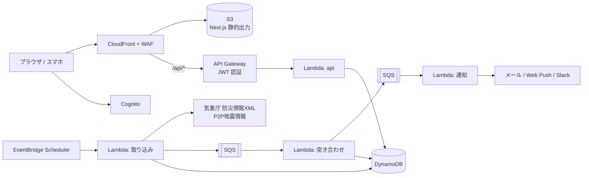

# saigai-timeline

登録した場所の周りで起きている災害の情報を、1本のタイムラインにまとめて見られる Web サービスです。気象庁などの公式情報に加え、Phase 2 からは SNS に投稿された現地の様子も表示します。

> **現在の状況: MVP をローカル環境で実装中**
> 気象庁の警報・注意報、土砂災害警戒情報、地震・津波の情報を取り込み、地点ごとのタイムラインとメール通知までをローカルで動かせます。AWS への構築はこれからです。

---

## 解決したいこと

| 課題 | このサービスでの対応 |
| --- | --- |
| 災害の情報が気象庁・自治体・SNS・ニュースに分かれている | 登録した地点ごとに、1本のタイムラインにまとめる |
| 全国の情報が流れてきて、自分に関係があるか分からない | 地点からの距離とエリアで絞り込む |
| 公式の発表は市区町村単位で、数分〜数十分遅れることがある | SNS の現地の投稿で補う。ただし「公式」「裏付けあり」「未確認」のラベルを付けて区別する |
| 法人は拠点が多く、状況の確認に時間がかかる | 全拠点の状況を一覧と地図でまとめて確認でき、Slack などに通知する |

法人向けの危機管理サービスの中核（拠点を登録 → 周辺の災害を集約 → 通知 → 状況を確認・記録）を、国内の自然災害に絞り、個人と中小企業が使える価格で提供することを目指します（[コンセプト](docs/01_concept_overview.md) 1.4）。

対象とする災害は大雨・洪水・土砂災害・地震・津波です。地点ごとに「どの災害を、どのレベルから表示・通知するか」を選べます（例: 地震は震度3以上を表示し、震度5弱以上で通知する）。

### 利用者

- **個人**: 自宅・実家・子どもの学校など、気になる場所が数か所ある人（[想定シナリオ](docs/02_use_case_scenarios.md) Part A）
- **法人**: 店舗・倉庫・工場など拠点を持つ企業、特に拠点が数〜数十の中小企業の総務・BCP・購買の担当。自社の拠点に加えて、主要な取引先の所在地も見守れます（同 Part B）

---

## システム構成

常時起動するサーバーを持たない、サーバーレスだけの構成です。個人の AWS アカウントでも運用を続けられる費用に抑えます。



| 領域 | 技術 |
| --- | --- |
| フロントエンド | Next.js（App Router、静的出力）、TypeScript、MapLibre GL JS + 国土地理院タイル |
| バックエンド | Go（AWS Lambda、arm64） |
| データ | DynamoDB（オンデマンド）、S3 |
| 認証 | Amazon Cognito（MFA / パスキー） |
| IaC | Terraform |
| CI/CD | GitHub Actions（AWS へは OIDC で認証） |
| API 仕様 | OpenAPI（Go と TypeScript の型を生成） |

---

## 設計で重視したこと

- **低コスト**: EC2・RDS・NAT Gateway を使いません。本番環境で月 約$15〜25、大阪の DR を含めて約$20〜33 の見込みです（[05](docs/05_system_architecture.md) 7章、[10](docs/10_disaster_recovery.md) 10章）
- **場所の情報を守る**: 自宅などの正確な座標・住所は、KMS で暗号化してから保存します。DB の中身が漏れても読めないようにしています。他人のデータにアクセスできないことは、全 API を対象に自動テストで確認します（[07](docs/07_security.md)）
- **長期のアクセスキーを作らない**: CI は OIDC で、人は MFA 付きの一時的な認証情報で AWS を操作します
- **災害時に止まらない**: 画面は CloudFront から配信します。東京リージョンが被災したときは、大阪リージョンに切り替えて、公式情報の取り込みと通知を続けます（[10](docs/10_disaster_recovery.md)）
- **安全にリリースする**: ブルーグリーン、ダークリリース、シャドー、カナリアで段階的に公開します。大規模な災害の対応中は、本番へのリリースを止めます（[09](docs/09_release_strategy.md)）
- **災害時の流れを再現して検証する**: 過去の電文 XML を流して、取り込みから通知までを手元で再現します。外部の API には依存せずにテストします（[08](docs/08_test_strategy.md)）

---

## ローカルで動かす

必要なもの: Docker、Go 1.26 以上、Node.js 24（`web/.nvmrc`）

```sh
docker compose up -d                       # DynamoDB Local と Mailpit

# 災害シナリオを流す（新潟県中越の大雨: 注意報 → 警報 → 特別警報 → 解除）
cd api
go run -tags local ./cmd/replay niigata-heavy-rain
go run -tags local ./cmd/local             # API サーバー（http://127.0.0.1:8080/api）

# 別のターミナルで画面を起動する
cd web
npm ci --ignore-scripts
npm run dev:local                          # http://localhost:3000 → alice でログイン
```

- 通知のメールは Mailpit（http://localhost:8025）で確認できます
- シナリオの一覧は `go run -tags local ./cmd/replay -list`（大雨・土砂災害警戒情報・地震・津波・訂正と取消・P2P地震情報との重複排除）
- API なしで画面だけを動かす場合は `npm run dev:mock`（`?scenario=heavy-rain` などでデータを切り替え）
- テストのコマンドは [CLAUDE.md](CLAUDE.md) の「コマンド」を参照してください

---

## ドキュメント

| # | ドキュメント | 内容 |
| --- | --- | --- |
| 01 | [コンセプト概要](docs/01_concept_overview.md) | 目的、対象、情報源、フェーズ分け |
| 02 | [想定シナリオ](docs/02_use_case_scenarios.md) | 個人・法人それぞれ 5 ケース |
| 03 | [画面一覧](docs/03_screens.md) | 画面構成、遷移、ワイヤーフレーム |
| 04 | [データモデル](docs/04_data_model.md) | DynamoDB のテーブル設計、アクセスパターン |
| 05 | [システム構成](docs/05_system_architecture.md) | AWS の構成、監視、概算コスト |
| 06 | [デプロイフロー](docs/06_deploy_flow.md) | GitHub Actions、OIDC、ロールバック |
| 07 | [セキュリティ](docs/07_security.md) | ゼロトラスト、暗号化、脆弱性対応 |
| 08 | [テスト・動作検証](docs/08_test_strategy.md) | テストの層、モック、災害シナリオの再現 |
| 09 | [リリース方式](docs/09_release_strategy.md) | ブルーグリーン、ダークリリース、カナリア、シャドー |
| 10 | [DR](docs/10_disaster_recovery.md) | 大阪リージョンへの切り替え、バックアップ |

---

## ロードマップ

| フェーズ | 内容 |
| --- | --- |
| Phase 0 | コンセプト・設計（現在） |
| Phase 1（MVP） | 公式情報による地点別タイムラインと地図、個人向け無料版、メール通知 |
| Phase 2 | SNS（Threads / Bluesky）の取り込み、信頼度ラベル、Web Push |
| Phase 3 | 法人向け（組織管理、拠点ダッシュボード、Slack / Teams 通知、CSV 出力） |
| Phase 4 | 課金、外部 API の提供 |

---

## 免責

このサービスは災害情報を補助的に提供するものです。避難するかどうかは、自治体・気象庁の公式情報に基づいて判断してください。

## ライセンス

[MIT](LICENSE)
