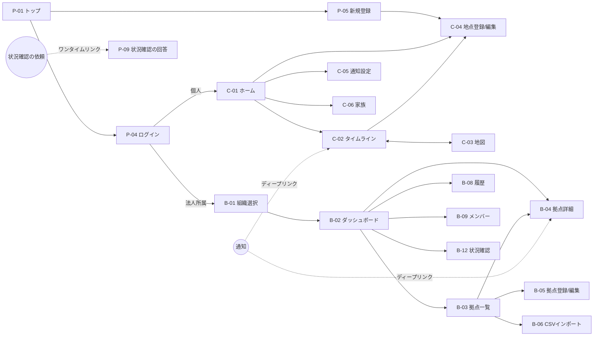

# 03. 画面一覧（たたき台）

> ステータス: Draft v0.2 / 2026-10-13（現地からの報告・状況確認の依頼・取引先タグ・音声読み上げを追加）
> 前提: [01_concept_overview.md](./01_concept_overview.md) / [02_use_case_scenarios.md](./02_use_case_scenarios.md)

---

## 1. 画面構成の方針

- **toC（個人）は「タイムライン中心」、toB（法人）は「ダッシュボード中心」**
- toC / toB は同じ Next.js アプリ内でルートを分ける（`/app/...` と `/org/...`）
- 家族共有は「type=family の小さな組織」として扱い、toB と同じ仕組みに乗せる（→ [04](./04_data_model.md)）
- Next.js は静的出力（`output: 'export'`）前提のため、**動的IDはパスではなくクエリパラメータで渡す**（例: `/app/location?id=xxx`）
  - 静的出力では事前生成していない動的ルート（`/locations/[id]`）が使えないため
- スマホ優先（災害時はほぼスマホで見られる）。法人ダッシュボードのみPC優先

---

## 2. 画面一覧

### 2.1 公開画面（ログイン不要）

| ID | 画面名 | パス | 主な要素 | フェーズ |
| --- | --- | --- | --- | --- |
| P-01 | トップ / LP | `/` | サービス説明、個人/法人の導線、デモ画像 | MVP |
| P-02 | 料金 | `/pricing` | 個人(無料/有料)、法人プラン比較 | Phase 4 |
| P-03 | 法人向け紹介 | `/business` | 法人ユースケース、問い合わせ導線 | Phase 3 |
| P-04 | ログイン | `/login` | メール + パスワード / パスキー、MFA | MVP |
| P-05 | 新規登録 | `/signup` | メール確認、規約同意 | MVP |
| P-06 | パスワード再設定 | `/reset-password` | メール経由のリセット | MVP |
| P-07 | 利用規約 / プライバシーポリシー / 免責 | `/terms` `/privacy` `/disclaimer` | 法務文書、データ出典のクレジット。`/.well-known/security.txt` も配置する | MVP |
| P-08 | 招待受諾 | `/invite?token=...` | 家族/組織への招待の受諾 | Phase 2 |
| P-09 | 状況確認の回答 | `/check?token=...` | 拠点名・発生した事象、「被害なし / 被害あり / 分からない」の選択、被害の内容（停電・建物・人・その他）、短いコメント。**ログイン不要**（ワンタイムリンク） | Phase 3 |

### 2.2 個人（toC）画面

| ID | 画面名 | パス | 主な要素 | フェーズ |
| --- | --- | --- | --- | --- |
| C-01 | ホーム（地点一覧） | `/app` | 登録地点カード（地点ごとの現在の最大レベルを色表示）、最新の重要イベント | MVP |
| C-02 | 地点タイムライン | `/app/location?id=` | 公式/SNS/報告タブ、レベル・種別フィルタ、信頼度ラベル、河川の水位・カメラの公式ページへのリンク（Phase 2）、「報告する」ボタン（家族共有の地点のみ。Phase 2） | MVP |
| C-03 | 地図ビュー | `/app/map?id=` | 地点・半径の円、イベントのピン、警報エリアの塗り | MVP |
| C-04 | 地点登録・編集 | `/app/location/edit?id=` | 住所で探す（国土地理院の住所検索）or 地図ピン、半径、ラベル名、**災害種別×レベル設定（表示/通知）** | MVP |
| C-05 | 通知設定 | `/app/settings/notifications` | 通知先（メール/Web Push/LINE）、時間帯指定、テスト送信 | MVP（LINEはPhase 4） |
| C-06 | 家族グループ | `/app/family` | メンバー一覧、招待リンク発行、共有地点 | Phase 2 |
| C-07 | アカウント設定 | `/app/settings/account` | メール変更、MFA/パスキー、ログイン履歴、退会（データ削除） | MVP |
| C-08 | プラン・支払い | `/app/settings/billing` | 現在のプラン、アップグレード | Phase 4 |

### 2.3 法人（toB）画面

| ID | 画面名 | パス | 主な要素 | フェーズ |
| --- | --- | --- | --- | --- |
| B-01 | 組織選択 | `/org` | 所属組織の一覧（複数所属に対応） | Phase 3 |
| B-02 | 拠点ダッシュボード | `/org/dashboard?org=` | ステータス別件数（平常/注意/警戒/危険）、警戒拠点リスト、全国地図、自社/取引先の切り替え、状況確認の回答状況、音声読み上げのオン/オフ | Phase 3 |
| B-03 | 拠点一覧 | `/org/locations?org=` | 検索・種別（自社/取引先）とタグの絞り込み・ソート、一括編集 | Phase 3 |
| B-04 | 拠点詳細（タイムライン） | `/org/location?org=&id=` | C-02 と同等＋担当者メモ、対応ステータス（未確認/確認中/対応済） | Phase 3 |
| B-05 | 拠点登録・編集 | `/org/location/edit?org=&id=` | C-04 と同等＋種別（自社/取引先）、タグ、担当者、通知チャネル選択、状況確認の依頼先（名前・メールアドレス）と依頼する条件 | Phase 3 |
| B-06 | CSVインポート | `/org/locations/import?org=` | テンプレートDL、アップロード、プレビュー・エラー表示、確定 | Phase 3 |
| B-07 | 通知チャネル | `/org/channels?org=` | Slack / Teams / メールの登録、テスト送信、拠点タグとの紐付け | Phase 3 |
| B-08 | 履歴検索・エクスポート | `/org/history?org=` | 期間・拠点・種別・レベルで検索、CSV出力 | Phase 3 |
| B-09 | メンバー・権限 | `/org/members?org=` | 招待、ロール（Owner/Admin/Editor/Viewer）、MFA必須設定 | Phase 3 |
| B-10 | 監査ログ | `/org/audit?org=` | 誰がいつ何を変更・出力したか | Phase 3 |
| B-11 | 組織設定 | `/org/settings?org=` | 組織名、デフォルトしきい値、データ保持期間、（将来）SSO | Phase 3 |
| B-12 | 状況確認 | `/org/checks?org=&id=` | 事象ごとの依頼の一覧、拠点ごとの回答（被害なし/被害あり/分からない/未回答）、未回答の拠点への再依頼、CSV 出力 | Phase 3 |

### 2.4 運営者向け（内部）

| ID | 画面名 | 主な要素 | フェーズ |
| --- | --- | --- | --- |
| A-01 | 取り込み状況 | 各ソースの最終取得時刻・エラー件数 | Phase 2 |

> 運営者画面は一般公開せず、CloudWatch ダッシュボードで代替するのを基本とする（画面を作るほど攻撃面が増えるため）。

---

## 3. 画面遷移（主要部分）



- 通知（メール/Push/Slack）から**該当地点のタイムラインに直接飛ぶ**のが最重要の導線
- 状況確認の依頼は、拠点の責任者（組織のメンバーとは限らない。取引先の担当者のこともある）にメールで届く。リンクを開くとログインせずに回答できる

---

## 4. 主要画面のワイヤーフレーム

### C-01 ホーム（地点一覧）

```
┌────────────────────────────┐
│ saigai-timeline       ⚙  👤 │
├────────────────────────────┤
│ ⚠ 現在 警報が出ている地点: 1  │
├────────────────────────────┤
│ 🔴 自宅（半径3km）           │
│   大雨警報 / 洪水警報         │
│   更新 14:32                │
├────────────────────────────┤
│ 🟡 実家（半径5km）           │
│   大雨注意報                 │
├────────────────────────────┤
│ 🟢 学校（半径1km）           │
│   情報なし                   │
├────────────────────────────┤
│        ＋ 地点を追加          │
└────────────────────────────┘
```

### C-02 地点タイムライン

```
┌────────────────────────────┐
│ ← 自宅（半径3km）      🗺 ✎ │
├────────────────────────────┤
│ [すべて] [公式] [SNS]        │
│ 種別: 大雨 地震 津波 土砂 ▼  │
├────────────────────────────┤
│ 14:32 【公式】🔴 警報        │
│ 大雨警報（浸水害）〇〇市      │
│ 気象庁                       │
├────────────────────────────┤
│ 14:25 【SNS】 複数投稿で裏付け │
│ 「〇〇川の水位がかなり上がっ  │
│  てる」ほか4件 (Threads)  ↗  │
├────────────────────────────┤
│ 14:18 【報告】 父             │
│ 無事。家の前の道路が少し冠水   │
├────────────────────────────┤
│ 14:10 【SNS】 未確認          │
│ 「△△交差点が冠水」(Bluesky)↗ │
├────────────────────────────┤
│ 13:50 【公式】🟡 注意報       │
│ 大雨注意報 〇〇市             │
├────────────────────────────┤
│ 近くの河川: 〇〇川の水位・カメラ↗│
│          [ 報告する ]         │
└────────────────────────────┘
 ※ 避難の判断は自治体・気象庁の
   公式情報に従ってください
```

- 公式情報とSNS投稿は**色・ラベルで明確に区別**する（デマ対策）
- SNS投稿は外部リンク・埋め込み表示（本文は保持しない方針 → [01](./01_concept_overview.md) 5章）
- 【報告】は家族のメンバーが「無事 / 被害あり / その他」と短いコメントで投稿したもの。公式・SNS とは別の色にする
- 河川の水位・カメラは画像を取り込まず、公式ページへのリンクだけを出す

### C-04 地点登録・編集

```
┌────────────────────────────┐
│ 地点を登録                   │
├────────────────────────────┤
│ 名前: [ 自宅             ]   │
│ 場所: (•) 地図で選ぶ ( ) 住所 │
│ ┌────────────────────────┐ │
│ │      [地図・ピン]        │ │
│ └────────────────────────┘ │
│ 半径: (1km) (3km) (5km) (10km)│
├────────────────────────────┤
│ 見る災害とレベル              │
│ 種別       表示       通知    │
│ 大雨・洪水 [注意報以上▼][警報以上▼]│
│ 土砂災害   [警報以上 ▼][警報以上▼]│
│ 地震       [震度3以上▼][震度5弱▼] │
│ 津波 ※沿岸のみ [注意報▼][警報以上▼]│
│ ☑ 警報級以上のときだけSNSも表示 │
├────────────────────────────┤
│           [ 保存 ]           │
└────────────────────────────┘
```

- **住所入力は任意**。地図ピンだけで登録できるようにし、個人情報の取得を最小化する（→ [07](./07_security.md)）

### B-02 拠点ダッシュボード（PC）

```
┌──────────────────────────────────────────────────────┐
│ 株式会社〇〇  ▼          拠点 52 / メンバー 8      👤  │
├────────────┬─────────────────────────────────────────┤
│ ダッシュボード│ [自社 40] [取引先 12] [すべて]   🔊 読み上げ: ON │
│ 拠点一覧     │ 🟢 平常 41   🟡 注意 7   🟠 警戒 3   🔴 危険 1 │
│ 状況確認     ├──────────────────────┬──────────────────┤
│ 履歴         │ 警戒以上の拠点          │                  │
│ 通知チャネル  │ 🔴 〇〇工場  津波警報   │   [全国地図]       │
│ メンバー     │    対応: 確認中(田中)   │   拠点ピン         │
│ 監査ログ     │    回答: 被害なし        │   警報エリア塗り    │
│ 設定         │ 🟠 △△店  大雨警報     │                  │
│              │    対応: 未確認 回答: 未回答│                  │
│              │ 🟠 □□倉庫 土砂災害警戒 │                  │
└────────────┴──────────────────────┴──────────────────┘
```

- 読み上げをオンにすると、新しく警戒以上になった拠点と状況確認の回答（被害あり）を、ブラウザの音声合成で読み上げる（例:「〇〇工場、津波警報」）。画面を見続けなくても、ほかの業務と並行できる
- 読み上げの設定は端末ごとに保存する（ブラウザの自動再生の制限があるため、オンにする操作は毎回の画面表示時に必要になる場合がある。要確認）

### P-09 状況確認の回答（ログイン不要）

```
┌────────────────────────────┐
│ 状況確認のお願い               │
│ 株式会社〇〇 から              │
├────────────────────────────┤
│ 拠点: 〇〇工場                │
│ 10/13 08:12 震度6弱（〇〇市）  │
├────────────────────────────┤
│ 拠点の状況を教えてください      │
│ ( ) 被害なし                  │
│ ( ) 被害あり                  │
│     ☐停電 ☐建物 ☐人 ☐その他   │
│ ( ) 分からない                │
│ コメント（任意・140字まで）     │
│ [                         ]  │
├────────────────────────────┤
│           [ 送信 ]            │
└────────────────────────────┘
```

- リンクは拠点・依頼ごとに発行し、72時間で無効にする。期限内なら回答を修正できる
- 画面には拠点名と事象だけを出し、組織のほかの拠点や情報は見せない

---

## 5. 共通UI要素

| 要素 | 内容 |
| --- | --- |
| レベル色 | 🟢 平常 / 🟡 注意報 / 🟠 警報 / 🔴 特別警報・大津波警報・震度6弱以上 / 🟣（予約） |
| 信頼度ラベル | 公式 / 複数投稿で裏付け / 未確認 / 報告（家族・社員・拠点の責任者からの報告） |
| 免責表示 | タイムライン下部に常時表示 |
| 出典表示 | 「出典: 気象庁」などデータソースのクレジット |
| 更新方式 | 画面表示中は60秒ごとにポーリング（警報級発生中は30秒）。WebSocketは使わない（コスト・運用負荷を避ける） |
| アクセシビリティ | 色だけに頼らずアイコン・文字でもレベルを表示 |
| 音声読み上げ | 法人ダッシュボードのみ。ブラウザの音声合成（Web Speech API）を使い、サーバーの費用はかからない |

---

次: [04_data_model.md](./04_data_model.md)
