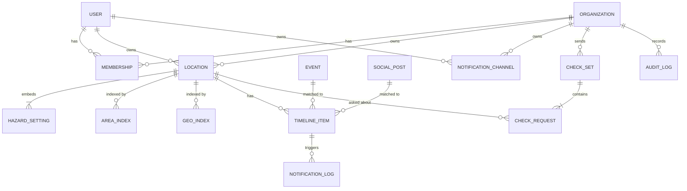
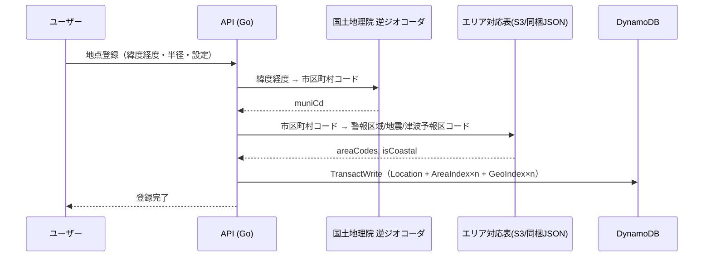

# 04. データモデル（たたき台）

> ステータス: Draft v0.2 / 2026-10-13（userId への変更、現地からの報告・状況確認の依頼・拠点の種別を追加）
> DB: DynamoDB（オンデマンド）。RDS/PostGIS は固定費がかかるため初期は使わない。

---

## 1. 設計方針

1. **地点と警報の突き合わせは「エリアコード」で行う**
   気象庁の警報・地震・津波情報は「市町村」「津波予報区」などのエリアコード単位で発表される。
   地点の登録時にエリアコードを求めて保存し、イベント受信時は「エリアコード → 該当地点」の逆引きで高速に判定する。
2. **SNS投稿の突き合わせは Geohash で行う**（Phase 2）
   投稿の推定位置を Geohash 化し、地点の半径をカバーする Geohash セルと照合する。
3. **重要度を共通の数値に正規化する**
   `severity: 1=情報, 2=注意報, 3=警報, 4=特別警報` に揃え、しきい値判定を一本化する。
4. **個人情報は最小化・暗号化**
   正確な緯度経度・住所はアプリ側で暗号化して保存。突き合わせには粒度の粗い Geohash とエリアコードだけを使う（→ [07](./07_security.md)）。
5. **データには保持期限（TTL）を付ける**
   不要になったデータは自動で消す（コスト削減と漏えい時の被害縮小を兼ねる）。

---

## 2. エンティティ一覧

| エンティティ | 説明 | 主な保存先 |
| --- | --- | --- |
| User | ログインユーザー（認証情報は Cognito 側） | `app` |
| Organization | 法人 / 家族グループ（`type`: company / family） | `app` |
| Membership | ユーザーと組織の所属・ロール | `app` |
| Location | 登録地点（所有者は User か Organization） | `app` |
| HazardSetting | 地点ごとの災害種別×レベル設定（Location に埋め込み） | `app` |
| AreaIndex | エリアコード → 地点の逆引き | `app` |
| GeoIndex | Geohash → 地点の逆引き（Phase 2） | `app` |
| NotificationChannel | 通知先（メール / Web Push / Slack / Teams / LINE） | `app` |
| Event | 正規化した公式情報（警報・地震・津波） | `events` |
| SocialPost | SNS投稿のメタ情報（本文は保持しない） | `events` |
| TimelineItem | 地点ごとのタイムライン項目（公式・SNS・報告） | `timeline` |
| Report | 現地からの報告（家族・社員の「無事」「被害あり」など）。TimelineItem の `kind=report` として保存 | `timeline` |
| CheckSet | 状況確認の依頼（1つの事象に対する、組織の拠点への依頼のまとまり） | `timeline` |
| CheckRequest | 拠点ごとの状況確認の依頼と回答 | `timeline` |
| CheckToken | 状況確認の回答用ワンタイムリンクのトークン | `app` |
| NotificationLog | 通知の送信記録 | `timeline` |
| AuditLog | 操作の監査ログ（主に法人） | `audit` |
| IngestCursor | 取り込み処理の進捗（最終取得位置） | `app` |

---

## 3. ER図（論理モデル）



---

## 4. 列挙値

| 名前 | 値 |
| --- | --- |
| `hazard` | `rain`（大雨）, `flood`（洪水）, `landslide`（土砂災害）, `earthquake`（地震）, `tsunami`（津波） |
| `severity` | `1`=情報, `2`=注意報, `3`=警報, `4`=特別警報 |
| `source` | `jma_xml`, `p2p_quake`, `threads`, `bluesky` |
| `reliability` | `official`（公式）, `corroborated`（複数投稿で裏付け）, `unverified`（未確認）, `reported`（家族・社員・拠点の責任者からの報告） |
| `timeline.kind` | `official`, `sns`, `report` |
| `location.category` | `own`（自社）, `partner`（取引先）。個人の地点は `own` のみ |
| `report.status` | `safe`（無事）, `damaged`（被害あり）, `other`（その他） |
| `check.answer` | `no_damage`（被害なし）, `damaged`（被害あり）, `unknown`（分からない）。未回答は属性なし |
| `check.damage` | `power`（停電）, `building`（建物）, `people`（人）, `other`（その他）。複数選択 |
| `org.type` | `company`, `family` |
| `role` | `owner`, `admin`, `editor`, `viewer` |
| `plan` | `free`, `personal_plus`, `business` |

### 4.1 severity へのマッピング

| 種別 | 1 情報 | 2 注意報 | 3 警報 | 4 特別警報 |
| --- | --- | --- | --- | --- |
| 大雨・洪水 | 記録的短時間大雨情報 等 | 大雨/洪水注意報 | 大雨/洪水警報 | 大雨特別警報 |
| 土砂災害 | — | — | 大雨警報（土砂災害） | 土砂災害警戒情報 / 大雨特別警報（土砂災害） |
| 地震（最大震度） | 震度1〜2 | 震度3〜4 | 震度5弱〜5強 | 震度6弱以上 |
| 津波 | 津波予報（若干の海面変動） | 津波注意報 | 津波警報 | 大津波警報 |

> 気象庁の防災気象情報は体系の見直しが進められているため、このマッピングは**設定ファイル（JSON）で管理**し、コード変更なしで差し替えられるようにする。最新体系は実装前に要確認。
> 地震のしきい値は UI 上「震度3以上」等で選ばせ、内部では `minIntensity` として別に保持する（severity より細かく選べるようにするため）。

---

## 5. 物理設計（DynamoDB）

テーブルは**用途とライフサイクルで4つに分ける**。

| テーブル | 用途 | TTL | PITR(バックアップ) |
| --- | --- | --- | --- |
| `app` | ユーザー・組織・地点・設定・逆引きインデックス | なし | 有効 |
| `events` | 公式イベント・SNS投稿メタ | あり | 無効（再取得可能） |
| `timeline` | 地点別タイムライン・通知ログ | あり（プラン別） | 無効 |
| `audit` | 監査ログ | あり（1年） | 有効 |

### 5.1 `app` テーブル（シングルテーブル設計）

| エンティティ | PK | SK | 主な属性 |
| --- | --- | --- | --- |
| User | `USER#<userId>` | `PROFILE` | displayName, plan, createdAt |
| SubIndex | `SUB#<issuer>#<sub>` | `META` | userId（Cognito の `sub` → `userId` の対応） |
| EmailIndex | `EMAIL#<emailHash>` | `META` | userId（DR 時に大阪の予備ユーザープールのユーザーを紐付ける。メールアドレスは HMAC でハッシュ化） |
| Organization | `ORG#<orgId>` | `META` | name, type, plan, retentionDays, mfaRequired, defaultHazardSettings |
| Membership | `ORG#<orgId>` | `MEMBER#<userId>` | role, invitedBy, joinedAt / GSI1: `USER#<userId>` / `ORG#<orgId>` |
| Location | `OWNER#<U\|O>#<id>` | `LOC#<locId>` | 下記 5.2 |
| AreaIndex | `AREA#<kind>#<code>` | `LOC#<locId>` | ownerKey, hazardSettings のコピー |
| GeoIndex | `GH5#<geohash5>` | `LOC#<locId>` | ownerKey, geohash6, radiusM |
| Channel | `OWNER#<U\|O>#<id>` | `CH#<chId>` | type, target_enc, verified, tags |
| Invite | `INVITE#<tokenHash>` | `META` | orgId, role, expiresAt（TTL） |
| IngestCursor | `INGEST#<source>` | `CURSOR` | lastFetchedAt, lastEntryId, etag |
| CheckToken | `CHECKTOKEN#<tokenHash>` | `META` | orgId, checkSetId, locId, expiresAt（TTL 72時間） |

- **GSI1**（`GSI1PK`, `GSI1SK`）: ユーザーが所属する組織一覧の取得
- **データのキーには Cognito の `sub` を使わず、アプリ独自の `userId`（ULID）を使う**。Cognito のユーザープールは別リージョンに複製できないため、DR で大阪の予備ユーザープールに切り替えたときも同じデータに紐付けられるようにする（→ [10](./10_disaster_recovery.md) 4.4）
  - 初回ログイン時に `userId` を発行し、`SubIndex` に保存する（条件付き書き込みで二重発行を防ぐ）
  - API はリクエストごとに `SubIndex` を引く。Lambda のメモリに短時間キャッシュし、読み取り回数を増やさない
- `kind` は `warn`（警報区域=市町村等）, `quake`（地震情報の市町村）, `tsunami`（津波予報区）
  - `<code>` は5桁の市区町村コード（気象庁の7桁の市町村等コードの先頭5桁）。富山市の「平地」「山間部」のような市町村の中の区域は、市町村の単位にまとめる（実際より広めに届く方向の誤差。Phase 2 で精度を改善する）
  - 政令指定都市の `warn` は、気象庁が市の単位で発表する市（横浜市など）は市のコード、区の単位で発表する市（2026年3月からの神戸市、広島市）は区のコードにする。どちらかは気象庁の発表区域の GIS データから作った一覧（`api/internal/area/warnkeys.json`、`genwarnmap` で生成）で判定する。`quake` は区のコード（震度は区の単位で発表される）
  - `tsunami` は津波予報区のコード（3桁）。沿岸の地点だけ登録する。海岸線は約 2km 四方のセルにして同梱している（`api/internal/area/tsunami.json`、`gentsunami` で生成）
- 地点・種別ごとの現在の状態（`timeline` テーブルの `S#<stateKey>`）でレベルの変化を判定する。地震は情報源によらない識別子（発生時刻（分）＋震央地名）を状態のキーにし、気象庁 XML と P2P地震情報から同じ地震が届いても重複しない。土砂災害警戒情報は、大雨警報（土砂災害）と同じ種別でも別の状態（`landslide:alert`）として持ち、互いの電文で上書きしない
- AreaIndex に設定値のコピーを持たせることで、**突き合わせ時に Location 本体を読まずに判定できる**（読み取り回数＝コスト削減）。Location 更新時に同時更新する（TransactWriteItems）

### 5.2 Location の属性

```jsonc
{
  "PK": "OWNER#U#01J9Y...",          // 個人所有: U#<userId> / 組織所有: O#<orgId>
  "SK": "LOC#01J9Z...",               // ULID
  "name": "自宅",
  "category": "own",                  // own（自社）/ partner（取引先）。法人向け
  "tags": ["関東", "店舗"],            // 法人向け
  "radiusM": 3000,
  "geohash6": "xn76ur",               // 平文。約1.2km×0.6kmの粗い位置（突き合わせ・地図の初期表示用）
  "coordEnc": "base64...",            // 正確な緯度経度（KMSデータキーで暗号化）
  "addressEnc": "base64...",          // 住所（任意入力・暗号化）
  "areaCodes": {
    "warn": "1310100",                // 警報・注意報の発表区域コード
    "quake": "1310100",               // 地震情報の市町村コード
    "tsunami": null                   // 沿岸地点のみ津波予報区コード
  },
  "isCoastal": false,                 // 海岸線から約 5km 以内か（気象庁の津波予報区の GIS データから判定）
  "tsunamiKey": null,                 // 沿岸の地点のみ: 一番近い津波予報区のコード（例: "340"）
  "tsunamiName": null,                // 津波予報区の名前（例: "新潟県上中下越"）
  "hazardSettings": {
    "rain":       { "display": 2, "notify": 3 },
    "flood":      { "display": 2, "notify": 3 },
    "landslide":  { "display": 3, "notify": 3 },
    "earthquake": { "displayMinIntensity": "3", "notifyMinIntensity": "5-" },
    "tsunami":    { "display": 2, "notify": 3 }
  },
  "snsOnlyWhenWarning": true,
  "channelIds": ["CH#..."],
  "checkContactEnc": "base64...",     // 状況確認の依頼先（名前・メールアドレス。KMSで暗号化）。法人向け
  "checkPolicy": { "earthquakeMinIntensity": "5-", "severity": 3 }, // 状況確認を依頼する条件。null なら依頼しない
  "quietHours": null,                 // 例: {"from":"23:00","to":"06:00","except":4}
  "version": 3,                       // 楽観ロック
  "createdAt": "...", "updatedAt": "..."
}
```

### 5.3 `events` テーブル

| エンティティ | PK | SK | 主な属性 |
| --- | --- | --- | --- |
| Event | `EVT#<eventId>` | `V#<version>` | source, hazard, severity, status(発表/継続/解除), title, summary, areaCodes[], maxIntensity, epicenter, tsunamiHeight, issuedAt, validUntil, rawS3Key, ttl |
| SocialPost | `POST#<source>#<postId>` | `META` | url, postedAt, geohash6(推定), hazardGuess, keywords, matchedPlaceName, ttl |

- `eventId` = `sha256(source + 気象庁の電文ID等)` で**冪等化**（同じ電文を二度処理しない。`attribute_not_exists` 条件付き書き込み）
- 気象庁XMLの原文は S3 に保存（`rawS3Key`）し、30日でライフサイクル削除
- SNS投稿は**本文を保存しない**。URL・投稿時刻・推定位置・判定に使ったキーワードのみ
- TTL: Event 400日（法人の1年保持に対応）、SocialPost 7日

### 5.4 `timeline` テーブル

| エンティティ | PK | SK | 主な属性 |
| --- | --- | --- | --- |
| TimelineItem | `LOC#<locId>` | `T#<issuedAt>#<itemId>` | kind(official/sns), eventRef, hazard, severity, reliability, summary, sourceUrl, notified, ackStatus(法人), ackBy, ttl |
| NotificationLog | `LOC#<locId>` | `N#<sentAt>#<id>` | channelId, result, errorCode, ttl |
| TimelineItem（報告） | `LOC#<locId>` | `T#<reportedAt>#<itemId>` | kind=report, reporterUserId, status, comment（140字まで）, ttl |
| CheckSet | `ORG#<orgId>` | `CHKSET#<createdAt>#<checkSetId>` | eventRef, hazard, severity, total, answered, damaged, ttl |
| CheckRequest | `CHKSET#<checkSetId>` | `LOC#<locId>` | locName, category, answer, damage[], comment（140字まで）, sentAt, answeredAt, reminderCount, ttl |

- タイムライン取得: `PK = LOC#<locId>` を SK 降順で Query（ページング）
- 状況確認: `matcher` が拠点の `checkPolicy` を満たすと判定したら、事象ごとに CheckSet を1つ作り（`eventRef` で冪等化）、拠点ごとに CheckRequest と CheckToken を作って `notify-queue` に依頼メールを投入する
  - 回答の集計（`answered`, `damaged`）は CheckSet の属性をアトミックに加算する。ダッシュボードは CheckSet を1件読むだけで回答状況を出せる
  - 回答用のトークンは推測できない乱数（128ビット以上）にし、DB にはハッシュだけを保存する。トークンで操作できるのは、その拠点のその依頼への回答だけにする
- 報告: 書き込めるのは、その地点を見る権限があるメンバー（家族グループのメンバー、組織の editor 以上）。報告をきっかけにした通知はしない（タイムラインに表示するだけ）
- 法人の履歴検索（期間×拠点）: 拠点ごとに SK の範囲指定 Query。全拠点横断の集計は件数が増えたら S3 エクスポート + Athena を検討
- TTL（プラン別）: 無料 7日 / 個人有料 90日 / 法人 1年（組織設定で短縮可）

### 5.5 `audit` テーブル

| PK | SK | 属性 |
| --- | --- | --- |
| `ORG#<orgId>` または `USER#<userId>` | `A#<ts>#<ulid>` | actorUserId, action, targetType, targetId, diff(要約), ipHash, userAgent, ttl(1年) |

- 記録する操作例: ログイン、MFA変更、地点の追加/削除、CSVインポート/エクスポート、メンバー招待・権限変更、通知チャネル変更
- **IPアドレスは生値で保存せずハッシュ化**（個人情報の最小化）

---

## 6. 主要なアクセスパターン

| # | 処理 | 方法 |
| --- | --- | --- |
| 0 | トークンの `sub` → `userId` | `app` GetItem PK=`SUB#<issuer>#<sub>`（Lambda 内で短時間キャッシュ） |
| 1 | ユーザーの地点一覧 | `app` Query PK=`OWNER#U#<userId>`, SK begins_with `LOC#` |
| 2 | 組織の拠点一覧 | `app` Query PK=`OWNER#O#<orgId>`, SK begins_with `LOC#` |
| 3 | ユーザーの所属組織一覧 | `app` GSI1 Query PK=`USER#<userId>` |
| 4 | 権限チェック（組織） | `app` GetItem PK=`ORG#<orgId>`, SK=`MEMBER#<userId>` |
| 5 | 警報受信 → 該当地点 | `app` Query PK=`AREA#warn#<code>`（イベントのエリアコードごと） |
| 6 | 地震受信 → 該当地点 | `app` Query PK=`AREA#quake#<code>`（震度観測のある市町村ごと） |
| 7 | 津波受信 → 該当地点 | `app` Query PK=`AREA#tsunami#<code>` |
| 8 | SNS投稿 → 該当地点 | `app` Query PK=`GH5#<geohash5>` → geohash6 と半径で絞り込み |
| 9 | 地点のタイムライン | `timeline` Query PK=`LOC#<locId>` 降順 |
| 10 | 履歴検索（期間指定） | `timeline` Query PK=`LOC#<locId>`, SK between |
| 11 | 監査ログ閲覧 | `audit` Query PK=`ORG#<orgId>` 降順 |
| 12 | 組織の状況確認の一覧 | `timeline` Query PK=`ORG#<orgId>`, SK begins_with `CHKSET#` 降順 |
| 13 | 状況確認の拠点ごとの回答 | `timeline` Query PK=`CHKSET#<checkSetId>` |
| 14 | 回答用リンクを開く | `app` GetItem PK=`CHECKTOKEN#<tokenHash>` → `timeline` GetItem PK=`CHKSET#<checkSetId>`, SK=`LOC#<locId>` |
| 15 | 自社/取引先での絞り込み | 拠点一覧（#2）を取得してから `category` で絞り込む（拠点数が数百までなら十分） |

---

## 7. 地点登録時のエリアコード決定



- エリア対応表は気象庁が公開しているコード表から生成し、**ビルド時にJSONとして同梱**（外部依存・コストを減らす）
- 半径が市町村境界をまたぐ場合は、半径内に含まれる隣接市町村のコードも AreaIndex に登録する（Phase 2 で精度改善）
- 逆ジオコーダが使えない場合のフォールバックとして、行政区域ポリゴン（国土数値情報）による判定も検討

---

## 8. 個人情報の分類

| データ | 分類 | 保存方法 | 保持 |
| --- | --- | --- | --- |
| メールアドレス | 個人情報 | Cognito（AWS管理の暗号化） | 退会まで |
| 表示名 | 個人情報（任意） | DynamoDB（保存時暗号化） | 退会まで |
| 住所 | **要配慮扱い（独自基準）** | アプリ層暗号化（KMS）。**入力は任意** | 退会 / 地点削除まで |
| 正確な緯度経度 | **要配慮扱い（独自基準）** | アプリ層暗号化（KMS） | 同上 |
| Geohash6（粗い位置） | 低 | 平文 | 同上 |
| Slack/Teams Webhook URL | 秘密情報 | アプリ層暗号化（KMS） | チャネル削除まで |
| 状況確認の依頼先（名前・メールアドレス） | 個人情報（組織のメンバーでない人を含む） | アプリ層暗号化（KMS） | 拠点の削除・依頼先の変更まで |
| 報告・状況確認の回答のコメント | 個人情報を含み得る | DynamoDB（保存時暗号化）。140字までに制限し、ログには出さない | タイムラインと同じ TTL |
| IPアドレス | 個人情報になり得る | ハッシュ化して監査ログへ | 1年 |
| SNS投稿 | 第三者の情報 | 本文は保存しない（URL・メタのみ） | 7日 |

- 退会時は `OWNER#U#<userId>` 配下の全データと関連インデックスを削除する（削除ジョブを用意）

---

次: [05_system_architecture.md](./05_system_architecture.md)
