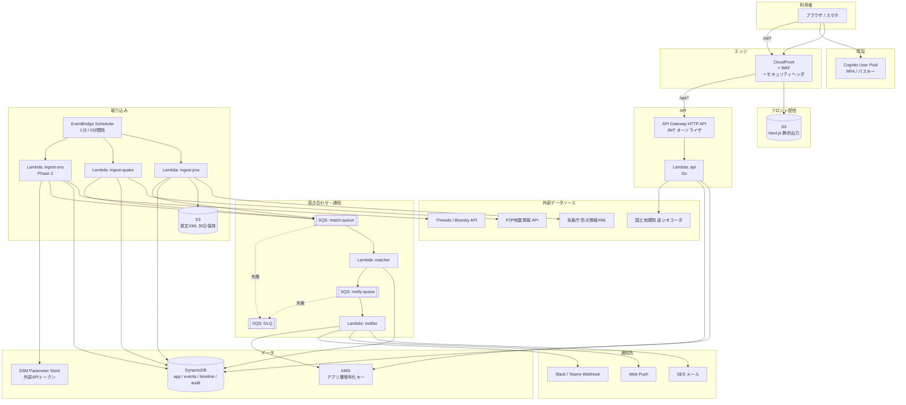
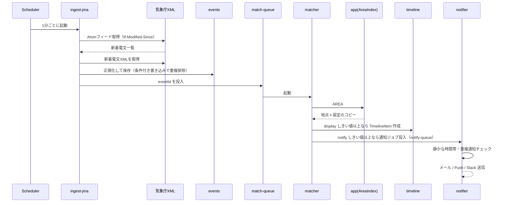

# 05. システム構成（たたき台）

> ステータス: Draft v0.1 / 2026-10-06
> 前提: フロント Next.js / バックエンド Go / インフラ AWS + Terraform / 低コスト優先

---

## 1. 構成方針

| 方針 | 内容 |
| --- | --- |
| サーバーレスのみ | 常時起動のサーバー（EC2/ECS/RDS）を持たない。固定費ゼロに近づける |
| VPC を使わない | Lambda は VPC 外で動かす。**NAT Gateway（月$30〜）が不要**。DynamoDB 等へは IAM 認証でアクセス |
| 静的配信を最大化 | Next.js は静的出力して S3 + CloudFront で配信。災害時のアクセス集中にも強い |
| 非同期で処理を分ける | 取り込み → 突き合わせ → 通知 を SQS でつなぎ、負荷集中や一部障害の影響を小さくする |
| 環境は AWS アカウントで分ける | dev / prod を別アカウントにし、権限と被害範囲を分離（→ [07](./07_security.md)） |
| リージョン | 東京（ap-northeast-1）。CloudFront 用の証明書のみ us-east-1 |

---

## 2. 全体構成図



- API は CloudFront 経由（`/api/*` をオリジン振り分け）にし、**同一オリジン化**して CORS を不要にする＋WAF を一箇所にまとめる

---

## 3. コンポーネント一覧

### 3.1 フロントエンド

| 項目 | 内容 |
| --- | --- |
| フレームワーク | Next.js（App Router, `output: 'export'`） |
| 配信 | S3（非公開）+ CloudFront（OAC でのみ S3 にアクセス可） |
| 地図 | MapLibre GL JS + 国土地理院タイル |
| 認証 | Cognito（Authorization Code + PKCE）。トークンはメモリ保持を基本とし、CSP で XSS 対策（→ [07](./07_security.md)） |
| 動的ルート | クエリパラメータ方式（`/app/location?id=`）。静的出力の制約のため |

> SSR が必要になった場合（OGP の動的生成など）は、その時点で Lambda（OpenNext 等）や Amplify Hosting を検討する。

### 3.2 Lambda 関数（すべて Go, `provided.al2023`, arm64）

| 関数 | トリガー | 役割 | 同時実行上限 |
| --- | --- | --- | --- |
| `api` | API Gateway | REST API 全般（1バイナリ内でルーティング） | 50（予約なし・上限のみ） |
| `ingest-jma` | Scheduler 1分 | 気象庁XMLフィード（Atom）を取得し、新規電文を解析・正規化して `events` に保存、`match-queue` へ投入 | 1 |
| `ingest-quake` | Scheduler 1分 | P2P地震情報 API から地震・津波情報を取得（気象庁XMLの補完・冗長化） | 1 |
| `ingest-sns` | Scheduler 5分（Phase 2） | 警報級が出ているエリアの地名＋キーワードで Threads / Bluesky を検索 | 1 |
| `matcher` | SQS | イベントのエリアコード → AreaIndex を引き、しきい値判定 → `timeline` 書き込み、通知対象を `notify-queue` へ | 10 |
| `notifier` | SQS | 通知先ごとに送信。失敗はリトライ → DLQ | 10 |
| `housekeeping` | Scheduler 1日 | 退会ユーザーのデータ削除、期限切れ招待の掃除 | 1 |

- **arm64（Graviton）** を使う: x86 より安く、Go はそのまま動く
- `api` を1関数にまとめることで、コールドスタート回数と管理対象を減らす
- 取り込み系は同時実行1にして二重処理を防ぐ（加えて `eventId` で冪等化 → [04](./04_data_model.md)）

### 3.3 データ処理の流れ（警報発表時）



- 同じ地点・同じ種別の通知は**レベルが上がった時と解除時のみ**送る（通知の連打を防ぐ）
- 特別警報・大津波警報は「静かな時間帯」設定を無視して通知する

### 3.4 データソース

| ソース | 取得方法 | 間隔 | 備考 |
| --- | --- | --- | --- |
| 気象庁 防災情報XML | PULL型 Atom フィード | 1分 | 高頻度フィードを差分取得。利用規約・出典表記を守る |
| P2P地震情報 API | REST（履歴取得） | 1分 | WebSocket はLambdaで常時接続できないため使わない |
| Threads API | キーワード検索 | 5分（警報級のときのみ） | 権限審査・レート制限は要確認 |
| Bluesky | 公開検索API | 5分（警報級のときのみ） | Firehose 常時購読は常駐プロセスが必要なため見送り |
| 国土地理院 逆ジオコーダ | REST | 地点登録時のみ | 結果は保存し、繰り返し呼ばない |

> **リアルタイム性の割り切り**: 定期取得のため、発表から表示まで最大1〜2分の遅れがある。緊急地震速報のような秒単位の速報は対象外とし、画面と規約に明記する。

---

## 4. 監視・運用

| 監視項目 | 方法 | 通知先 |
| --- | --- | --- |
| **取り込みの停止**（最重要） | 各ソースの最終取得成功時刻をカスタムメトリクス化し、5分以上更新がなければアラーム | 運営者メール / Slack |
| Lambda エラー率 | CloudWatch アラーム | 同上 |
| DLQ にメッセージが溜まった | ApproximateNumberOfMessagesVisible > 0 | 同上 |
| API 5xx / レイテンシ | API Gateway メトリクス | 同上 |
| 料金 | AWS Budgets（月$20超で通知、$50で強い警告） | 運営者メール |
| セキュリティ | GuardDuty / CloudTrail（→ [07](./07_security.md)） | 同上 |

- ログは JSON 構造化ログ（Go の `log/slog`）。**個人情報（住所・座標・メール）をログに出さない**
- ログ保持期間: 30日（コスト抑制）。監査用途は `audit` テーブルと CloudTrail で担保

---

## 5. 災害時のアクセス集中への備え

| 対策 | 内容 |
| --- | --- |
| 静的配信 | 画面は CloudFront から配信。オリジン負荷なし |
| API の流量制限 | API Gateway のスロットリング＋WAF のレート制限で過負荷・悪用を防ぐ |
| DynamoDB オンデマンド | 急な負荷増に自動追従 |
| 非同期処理 | 通知は SQS に溜めて順次処理。送信先のレート制限（SES 等）にも対応 |
| ポーリング間隔 | 画面のポーリングは30〜60秒。クライアント側でジッター（ばらつき）を入れて集中を避ける |

---

## 6. 環境構成

| 環境 | AWSアカウント | 用途 | デプロイ |
| --- | --- | --- | --- |
| dev | saigai-dev | 開発・結合確認 | main マージで自動 |
| prod | saigai-prod | 本番 | 承認後に手動（→ [06](./06_deploy_flow.md)） |
| （管理） | 管理アカウント | AWS Organizations・運営者用 IAM ユーザー（MFA 必須・アクセスキーなし）・請求 | Terraform（手動適用） |

- AWS Organizations は無料。アカウントを分けることで「dev の権限で本番データに触れない」状態をつくる
- Terraform の state は各アカウントの S3 に保存（バージョニング＋暗号化）。ロックは **S3 ネイティブロック（`use_lockfile`）** を使い DynamoDB のロックテーブルは不要にする

### 6.1 リポジトリ構成（モノレポ）

```
saigai-portal/
├── web/                 # Next.js
├── api/                 # Go（cmd/ に Lambda ごとの main）
│   ├── cmd/
│   │   ├── api/
│   │   ├── ingest-jma/
│   │   ├── ingest-quake/
│   │   ├── ingest-sns/
│   │   ├── matcher/
│   │   ├── notifier/
│   │   └── housekeeping/
│   └── internal/        # ドメインロジック・リポジトリ・JMAパーサ等
├── infra/               # Terraform
│   ├── modules/         # 再利用モジュール（lambda, api, web, data, monitoring, security）
│   └── envs/
│       ├── dev/
│       └── prod/
├── docs/
└── .github/
    ├── workflows/
    ├── dependabot.yml
    └── CODEOWNERS
```

---

## 7. 概算コスト（MVP / 月額）

| サービス | 想定 | 概算 |
| --- | --- | --- |
| Lambda | 定期実行 約13万回 + API | 無料枠内〜$1 |
| DynamoDB | オンデマンド・小規模 | 〜$1 |
| S3 + CloudFront | 小規模配信 | 無料枠内〜$1 |
| API Gateway HTTP API | 〜100万リクエスト | 〜$1 |
| SQS / EventBridge Scheduler | 小規模 | 無料枠内 |
| Cognito | 小規模MAU | 無料枠内 |
| SES | 数千通 | 〜$1 |
| KMS | カスタマー管理キー 1〜2個 | $1〜2 |
| Route 53 | ホストゾーン1つ | $0.5 |
| WAF | Web ACL＋数ルール | $6〜10 ※ |
| GuardDuty | 小規模アカウント | $1〜3 |
| CloudWatch | ログ・アラーム少数 | $1〜3 |
| **合計** | | **約 $15〜25 / 月**（prod。dev は WAF なしで数ドル） |

> ※ CloudFront の定額プラン（WAF込みの無料/低額プラン）が使える場合は WAF 費用を圧縮できる可能性がある。料金・無料枠は変わるため、構築時に最新を確認すること。
> 01 では「〜$10/月」としていたが、セキュリティ対策（WAF・GuardDuty・KMS）を加えると上記程度になる見込み。

---

次: [06_deploy_flow.md](./06_deploy_flow.md)
