# 06. デプロイフロー（GitHub Actions）

> ステータス: Draft v0.1 / 2026-10-06
> 前提: [05_system_architecture.md](./05_system_architecture.md)

---

## 1. 方針

| 方針 | 内容 |
| --- | --- |
| **長期のアクセスキーを持たない** | GitHub Actions → AWS は **OIDC** で一時クレデンシャルを取得。IAMユーザー・アクセスキーは作らない |
| インフラとアプリを分ける | インフラは Terraform、Lambda のコードと画面は CI からデプロイ。役割と権限を分ける |
| PR で全部チェック | テスト・静的解析・脆弱性スキャン・`terraform plan` を PR 上で必ず通す |
| prod だけ・承認制 | AWS には prod だけを作る（→ [05](./05_system_architecture.md) 6章）。PR と main では `terraform plan` まで。prod へはタグ作成 → 承認後にデプロイ |
| すぐ戻せる | Lambda はバージョン＋エイリアス、画面は S3 のバージョン単位で切り戻し可能にする |

---

## 2. ブランチ戦略

- **GitHub Flow**（`main` + 作業ブランチ）
- `main` はブランチ保護:
  - PR 必須、CI 成功必須、直接 push 禁止、force push 禁止
  - 署名付きコミット推奨
  - `CODEOWNERS` で `infra/` と `.github/` の変更はレビュー必須
- 本番リリースは `v1.2.3` 形式のタグで行う

---

## 3. 全体フロー

```mermaid
flowchart LR
  Dev[開発者] -->|push| PR[Pull Request]

  subgraph CI[PR時: ci.yml]
    direction TB
    W[web: lint / 型チェック / test / build]
    G[api: vet / golangci-lint / test / govulncheck]
    T[infra: fmt / validate / tflint / trivy config]
    S[共通: gitleaks / 依存関係レビュー]
    P[terraform plan（prod・読み取り専用）→ 件数だけをジョブの要約に出す]
  end

  PR --> CI
  CI -->|レビュー承認 + マージ| Main[main]

  Main -->|タグ v*.*.*| Tag[リリースタグ]
  subgraph DP[タグ作成時: deploy-prod.yml]
    direction TB
    PP[terraform plan（prod）]
    AP{{承認<br/>GitHub Environment: prod}}
    PA[terraform apply（prod）]
    PB[Lambda デプロイ（prod）]
    PC[web デプロイ（prod）]
    PS[スモークテスト → 失敗時は自動ロールバック]
  end
  Tag --> PP --> AP --> PA --> PB --> PC --> PS
```



### 3.1 ワークフロー一覧

| ファイル | トリガー | 内容 |
| --- | --- | --- |
| `ci.yml` | pull_request / push to main | テスト・静的解析・脆弱性スキャン・`terraform plan`（prod。読み取り専用） |
| `deploy-prod.yml` | push tag `v*` | 承認後に prod へデプロイ |
| `security-scheduled.yml` | 毎週月曜（cron） | 依存関係の再スキャン、DAST（本番にパッシブなベースラインスキャンのみ）→ [07](./07_security.md) |
| `rollback.yml` | 手動（workflow_dispatch） | 指定バージョンへ Lambda エイリアス・Web を戻す |

---

## 4. AWS との認証（OIDC）

### 4.1 IAM ロール

1つのアカウントに、用途別にロールを分けて作る（最小権限。`infra/bootstrap` で作成）。

| ロール | 使うワークフロー | 権限 | 信頼条件（`sub`） |
| --- | --- | --- | --- |
| `saigai-gha-plan` | ci.yml / deploy-prod.yml の plan | 読み取りのみ（ReadOnly + state 読み取り） | `repo:masuzuki1028/saigai-portal:pull_request`、`...:ref:refs/heads/main`、`...:environment:prod-plan` |
| `saigai-gha-deploy` | deploy-prod.yml の deploy | prod の Terraform 適用・Lambda/S3 更新。IAM は `saigai-prod-*` のロール・ポリシーだけ | `repo:masuzuki1028/saigai-portal:environment:prod` |
| `saigai-readonly` | 運営者（手元・Claude Code） | 読み取りのみ | 運営者用の IAM ユーザー（MFA） |
| `saigai-admin` | 運営者（最初の構築・緊急時） | 管理者 | 運営者用の IAM ユーザー（MFA） |

- **PR（フォークを含む）からは書き込み権限のロールを引き受けられない**ようにする
- prod の書き込みロールは「`prod` Environment の承認を通ったジョブ」からのみ使える
- 適用ロールでも IAM 系の権限は対象リソース（`saigai-*`）に限定し、Permissions Boundary を付ける

### 4.2 信頼ポリシー例（prod デプロイ用）

```json
{
  "Version": "2012-10-17",
  "Statement": [{
    "Effect": "Allow",
    "Principal": { "Federated": "arn:aws:iam::<ACCOUNT_ID>:oidc-provider/token.actions.githubusercontent.com" },
    "Action": "sts:AssumeRoleWithWebIdentity",
    "Condition": {
      "StringEquals": {
        "token.actions.githubusercontent.com:aud": "sts.amazonaws.com",
        "token.actions.githubusercontent.com:sub": "repo:masuzuki1028/saigai-portal:environment:prod"
      }
    }
  }]
}
```

---

## 5. ワークフロー例（抜粋）

> 外部 Action はタグではなく **コミットSHAで固定**する（改ざんされた Action の取り込みを防ぐ）。下記は読みやすさのためタグ表記。

**公開リポジトリでの注意**（Actions のログと PR は誰でも読める）

| 項目 | 方針 |
| --- | --- |
| 秘密の値 | トークン・パスワード・API キーは **Secrets** に置く（登録後は誰も値を見られず、ログでは伏せられる）。**Variables は平文でログにも出る**ため、公開されて困らない値だけに使う |
| アカウント ID を含む値 | ロールの ARN・state のバケット名は秘密ではないが、ログに出さないよう Secrets に置く |
| AWS の認証情報 | GitHub には置かない（OIDC）。アプリが使う外部 API のトークンは SSM Parameter Store（SecureString）に置く |
| `terraform plan` | 全文を PR のコメント・ログ・アーティファクトに出さない（構成とアカウント ID が見えるため）。件数だけをジョブの要約に出し、全文は手元で `saigai-readonly` で確認する（`.github/scripts/tf-plan.sh`）。plan のファイルも state の値を含むため、アーティファクトにしない。deploy のジョブでは承認のあとで plan を作り直し、承認前の plan と差分（リソースと操作）のハッシュが一致するときだけ apply する |
| 出力の値 | `terraform.tfvars` は `TF_VARS_PROD`（Secrets）から作る。アカウント ID・ドメイン・メールアドレス・バケット名などは `::add-mask::` で伏せ、AWS CLI の出力は `--query` で必要な値だけにする（ARN を出さない） |
| フォークからの PR | `pull_request` で動かす（フォークには Secrets も OIDC のトークンも渡らない）。`pull_request_target` は使わない |
| 秘密情報の混入 | コミット前に gitleaks（`.githooks/pre-commit`）、CI でも gitleaks。万一 push したら、履歴から消すだけでなく、すぐにキーを無効化して作り直す |

### 5.1 `ci.yml`

```yaml
name: ci
on:
  pull_request:

permissions:
  contents: read          # デフォルトは読み取りのみ

jobs:
  api:
    runs-on: ubuntu-latest
    defaults: { run: { working-directory: api } }
    steps:
      - uses: actions/checkout@v4
      - uses: actions/setup-go@v5
        with: { go-version-file: api/go.mod }
      - run: go vet ./...
      - uses: golangci/golangci-lint-action@v6
        with: { working-directory: api }
      - run: go test -race -cover ./...
      - run: go run golang.org/x/vuln/cmd/govulncheck@latest ./...

  web:
    runs-on: ubuntu-latest
    defaults: { run: { working-directory: web } }
    steps:
      - uses: actions/checkout@v4
      - uses: actions/setup-node@v4
        with: { node-version-file: web/.nvmrc, cache: npm, cache-dependency-path: web/package-lock.json }
      - run: npm ci --ignore-scripts
      - run: npm run lint && npm run typecheck && npm test
      - run: npm audit --audit-level=high
      - run: npm run build

  infra:
    runs-on: ubuntu-latest
    steps:
      - uses: actions/checkout@v4
      - uses: hashicorp/setup-terraform@v3
      - run: terraform fmt -check -recursive infra
      - uses: terraform-linters/setup-tflint@v4
      - run: tflint --recursive --chdir=infra
      - uses: aquasecurity/trivy-action@master   # 実際はSHA固定
        with: { scan-type: config, scan-ref: infra, severity: 'HIGH,CRITICAL', exit-code: '1' }

  secrets:
    runs-on: ubuntu-latest
    steps:
      - uses: actions/checkout@v4
        with: { fetch-depth: 0 }
      - uses: gitleaks/gitleaks-action@v2

  dependency-review:
    runs-on: ubuntu-latest
    steps:
      - uses: actions/checkout@v4
      - uses: actions/dependency-review-action@v4
        with: { fail-on-severity: high }

  plan:
    needs: [infra]
    runs-on: ubuntu-latest
    permissions:
      contents: read
      id-token: write        # OIDC
      # 公開リポジトリのため、plan の全文は PR のコメントにもログにも出さない（下の注意を参照）
    steps:
      - uses: actions/checkout@v4
      - uses: aws-actions/configure-aws-credentials@v4
        with:
          role-to-assume: ${{ secrets.PLAN_ROLE_ARN }}   # アカウント ID を含むため Secrets に置く
          aws-region: ap-northeast-1
      - uses: hashicorp/setup-terraform@v3
      - run: terraform -chdir=infra/envs/prod init -input=false -backend-config="bucket=${{ secrets.TF_STATE_BUCKET }}"
      - run: terraform -chdir=infra/envs/prod plan -input=false -no-color -lock=false -out=tfplan > /dev/null
      # 追加・変更・削除の件数だけをジョブの要約に出す
      - run: terraform -chdir=infra/envs/prod show -json tfplan | jq -r '[.resource_changes[].change.actions | join(",")] | group_by(.) | map("\(.[0]): \(length)") | .[]' >> "$GITHUB_STEP_SUMMARY"
```

### 5.2 `deploy-prod.yml`

実際のファイルは `.github/workflows/deploy-prod.yml`。処理は `.github/scripts/` のスクリプトにまとめている。

| ジョブ | Environment | ロール | 内容 |
| --- | --- | --- | --- |
| `plan` | `prod-plan`（承認なし） | `saigai-gha-plan` | `terraform plan`（`tf-plan.sh`）。件数を要約に出し、差分のハッシュを次のジョブに渡す |
| `deploy` | `prod`（承認が必要） | `saigai-gha-deploy` | 1. plan をやり直し、承認前とハッシュが一致することを確認 → 差分があれば `terraform apply`<br>2. Lambda を arm64 でビルド（`build-lambda.sh`）<br>3. 画面をビルド（Cognito の設定は `terraform output` から渡す。なければ失敗させる）<br>4. Lambda のコードを更新してバージョンを公開し、`live` エイリアスを切り替える（`deploy-lambda.sh`。切り替え前のバージョンを記録）<br>5. 画面を S3 に置き、CloudFront のキャッシュを消す（`deploy-web.sh`）<br>6. スモークテスト（`smoke.sh`。`/api/health` と主要な画面が 200）<br>7. どこかで失敗したら、`live` エイリアスを記録したバージョンに戻す（`rollback-lambda.sh`） |

- Lambda の zip は直接アップロードする（50MB 未満のため、成果物用の S3 バケットは作らない）
- 取り込みの定期実行（`ingest_enabled`）は、最初のデプロイが成功してから true にする

## 6. デプロイ手順の詳細

### 6.1 Lambda（Go）

1. `GOOS=linux GOARCH=arm64 CGO_ENABLED=0 go build -trimpath -ldflags="-s -w" -o bootstrap ./cmd/<name>`
2. `bootstrap` を zip にまとめる（コミットは `vcs.revision` としてバイナリに埋め込まれ、書き込みの `writtenBy` に使う）
3. `aws lambda update-function-code --publish`（zip を直接送る）
4. エイリアス `live` を新バージョンへ（API Gateway・SQS・Scheduler は `live` を呼ぶ）
5. Terraform 側はコード本体を管理しない（`ignore_changes = [s3_key, ...]`）。インフラ変更とコード変更を独立させる

### 6.2 Web（Next.js）

> リリースごとにプレフィックスを分けるブルーグリーン方式に変更予定（→ [09](./09_release_strategy.md) 5.1）。

1. `npm ci --ignore-scripts && npm run build`（`out/` に静的出力）
2. `aws s3 sync out/ s3://saigai-<env>-web/ --delete`
   - ハッシュ付きファイル（`_next/static/*`）は長期キャッシュ、HTML は短いキャッシュ
3. CloudFront の HTML パスのみ無効化（無効化は月1,000パスまで無料）
   - `.mjs`（MapLibre の Web Worker）は `Content-Type: text/javascript` で配信する（S3 に置くときに明示する。違うと地図の図形が描画されない）
   - 静的出力は `/login` → `login.html` のように出力される。同じ名前のディレクトリ（`login/`）もあるため、CloudFront Functions で拡張子のないパスを `.html` に書き換える（ローカルでは `web/scripts/serve-out.mjs` が同じ処理をしている）
4. S3 バケットはバージョニング有効 → ロールバック時は前バージョンを再配置

### 6.3 Terraform

- state は `infra/bootstrap` で作る S3 バケットに置く（ネイティブロック）。bootstrap 自身の state も同じバケットに移す
- prod は**plan したファイルをそのまま apply**（plan と apply の間に差分が入らないようにする）
- `prevent_destroy` を DynamoDB テーブル・KMS キー・S3（データ系）に設定

### 6.4 データ移行

- DynamoDB はスキーマレスのため基本はマイグレーション不要
- 属性追加は「読み取り時にデフォルト値で補う」実装で後方互換を保つ
- 既存データの一括変換が必要な場合は `api/cmd/migrate-<name>` を作り、手動ワークフローで実行

---

## 7. ロールバック

| 対象 | 方法 | 目安時間 |
| --- | --- | --- |
| Lambda | `rollback.yml` でエイリアス `live` を前バージョンへ | 1分以内 |
| Web | S3 のオブジェクトを前バージョンに戻して CloudFront 無効化（または前タグを再デプロイ） | 数分 |
| インフラ | 前タグの Terraform を再 apply（データ系リソースは `prevent_destroy` で保護） | 数分〜 |

---

## 8. コストとプランの注意

| 項目 | 内容 |
| --- | --- |
| GitHub Actions 実行時間 | 公開リポジトリは無料。非公開は無料枠（月2,000分）を超えないよう、パスフィルタで変更があった部分だけ実行する |
| Environment の承認機能 | 公開リポジトリなら無料プランで利用可。**非公開リポジトリでは有料プランが必要**な場合がある（要確認） |
| CodeQL / シークレットスキャン | 公開リポジトリなら無料。非公開では有料（GitHub Advanced Security）。代替として gitleaks・gosec・Semgrep(OSS) を使う |

> ポートフォリオとして**公開リポジトリにする場合、GitHub のセキュリティ機能の多くを無料で使える**。その場合はシークレットを絶対にコミットしない運用（gitleaks + push protection）を徹底する。

---

次: [07_security.md](./07_security.md)
