# 06. デプロイフロー（GitHub Actions）

> ステータス: Draft v0.1 / 2026-10-06
> 前提: [05_system_architecture.md](./05_system_architecture.md)

---

## 1. 方針

| 方針 | 内容 |
| --- | --- |
| **長期のアクセスキーを持たない** | GitHub Actions → AWS は **OIDC** で一時クレデンシャルを取得。IAMユーザー・アクセスキーは作らない |
| インフラとアプリを分ける | インフラは Terraform、Lambda のコードと画面は CI からデプロイ。役割と権限を分ける |
| PR で全部チェック | テスト・静的解析・脆弱性スキャン・`terraform plan` を PR 上で必ず通す |
| dev は自動、prod は承認制 | main マージで dev へ自動デプロイ。prod はタグ作成 → 承認後にデプロイ |
| すぐ戻せる | Lambda はバージョン＋エイリアス、画面は S3 のバージョン単位で切り戻し可能にする |

---

## 2. ブランチ戦略

- **GitHub Flow**（`main` + 作業ブランチ）
- `main` はブランチ保護:
  - PR 必須、CI 成功必須、直接 push 禁止、force push 禁止
  - 署名付きコミット推奨
  - `CODEOWNERS` で `infra/` と `.github/` の変更はレビュー必須
- 本番リリースは `v1.2.3` 形式のタグで行う

---

## 3. 全体フロー

```mermaid
flowchart LR
  Dev[開発者] -->|push| PR[Pull Request]

  subgraph CI[PR時: ci.yml]
    direction TB
    W[web: lint / 型チェック / test / build]
    G[api: vet / golangci-lint / test / govulncheck]
    T[infra: fmt / validate / tflint / trivy config]
    S[共通: gitleaks / 依存関係レビュー]
    P[terraform plan（dev）→ PRにコメント]
  end

  PR --> CI
  CI -->|レビュー承認 + マージ| Main[main]

  subgraph DD[main マージ時: deploy-dev.yml]
    direction TB
    DA[terraform apply（dev）]
    DB[Lambda ビルド・デプロイ（dev）]
    DC[web ビルド → S3 → CloudFront 無効化]
    DS[スモークテスト]
  end

  Main --> DD

  Main -->|タグ v*.*.*| Tag[リリースタグ]
  subgraph DP[タグ作成時: deploy-prod.yml]
    direction TB
    PP[terraform plan（prod）]
    AP{{承認<br/>GitHub Environment: prod}}
    PA[terraform apply（prod）]
    PB[Lambda デプロイ（prod）]
    PC[web デプロイ（prod）]
    PS[スモークテスト → 失敗時は自動ロールバック]
  end
  Tag --> PP --> AP --> PA --> PB --> PC --> PS
```



### 3.1 ワークフロー一覧

| ファイル | トリガー | 内容 |
| --- | --- | --- |
| `ci.yml` | pull_request | テスト・静的解析・脆弱性スキャン・`terraform plan`(dev) |
| `deploy-dev.yml` | push to main | dev へ自動デプロイ |
| `deploy-prod.yml` | push tag `v*` | 承認後に prod へデプロイ |
| `security-scheduled.yml` | 毎週月曜（cron） | 依存関係の再スキャン、DAST（dev 環境）→ [07](./07_security.md) |
| `rollback.yml` | 手動（workflow_dispatch） | 指定バージョンへ Lambda エイリアス・Web を戻す |

---

## 4. AWS との認証（OIDC）

### 4.1 IAM ロール

各AWSアカウントに、用途別にロールを分けて作る（最小権限）。

| ロール | 使うワークフロー | 権限 | 信頼条件（`sub`） |
| --- | --- | --- | --- |
| `gha-plan-dev` | ci.yml | 読み取りのみ（ReadOnly + state 読み取り） | `repo:masuzuki1028/saigai-portal:pull_request` |
| `gha-deploy-dev` | deploy-dev.yml | dev の Terraform 適用・Lambda/S3 更新 | `repo:masuzuki1028/saigai-portal:ref:refs/heads/main` |
| `gha-plan-prod` | deploy-prod.yml | 読み取りのみ | `repo:masuzuki1028/saigai-portal:environment:prod-plan` |
| `gha-deploy-prod` | deploy-prod.yml | prod の Terraform 適用・Lambda/S3 更新 | `repo:masuzuki1028/saigai-portal:environment:prod` |

- **PR（フォークを含む）からは書き込み権限のロールを引き受けられない**ようにする
- prod の書き込みロールは「`prod` Environment の承認を通ったジョブ」からのみ使える
- 適用ロールでも IAM 系の権限は対象リソース（`saigai-*`）に限定し、Permissions Boundary を付ける

### 4.2 信頼ポリシー例（prod デプロイ用）

```json
{
  "Version": "2012-10-17",
  "Statement": [{
    "Effect": "Allow",
    "Principal": { "Federated": "arn:aws:iam::<PROD_ACCOUNT_ID>:oidc-provider/token.actions.githubusercontent.com" },
    "Action": "sts:AssumeRoleWithWebIdentity",
    "Condition": {
      "StringEquals": {
        "token.actions.githubusercontent.com:aud": "sts.amazonaws.com",
        "token.actions.githubusercontent.com:sub": "repo:masuzuki1028/saigai-portal:environment:prod"
      }
    }
  }]
}
```

---

## 5. ワークフロー例（抜粋）

> 外部 Action はタグではなく **コミットSHAで固定**する（改ざんされた Action の取り込みを防ぐ）。下記は読みやすさのためタグ表記。

### 5.1 `ci.yml`

```yaml
name: ci
on:
  pull_request:

permissions:
  contents: read          # デフォルトは読み取りのみ

jobs:
  api:
    runs-on: ubuntu-latest
    defaults: { run: { working-directory: api } }
    steps:
      - uses: actions/checkout@v4
      - uses: actions/setup-go@v5
        with: { go-version-file: api/go.mod }
      - run: go vet ./...
      - uses: golangci/golangci-lint-action@v6
        with: { working-directory: api }
      - run: go test -race -cover ./...
      - run: go run golang.org/x/vuln/cmd/govulncheck@latest ./...

  web:
    runs-on: ubuntu-latest
    defaults: { run: { working-directory: web } }
    steps:
      - uses: actions/checkout@v4
      - uses: actions/setup-node@v4
        with: { node-version-file: web/.nvmrc, cache: npm, cache-dependency-path: web/package-lock.json }
      - run: npm ci --ignore-scripts
      - run: npm run lint && npm run typecheck && npm test
      - run: npm audit --audit-level=high
      - run: npm run build

  infra:
    runs-on: ubuntu-latest
    steps:
      - uses: actions/checkout@v4
      - uses: hashicorp/setup-terraform@v3
      - run: terraform fmt -check -recursive infra
      - uses: terraform-linters/setup-tflint@v4
      - run: tflint --recursive --chdir=infra
      - uses: aquasecurity/trivy-action@master   # 実際はSHA固定
        with: { scan-type: config, scan-ref: infra, severity: 'HIGH,CRITICAL', exit-code: '1' }

  secrets:
    runs-on: ubuntu-latest
    steps:
      - uses: actions/checkout@v4
        with: { fetch-depth: 0 }
      - uses: gitleaks/gitleaks-action@v2

  dependency-review:
    runs-on: ubuntu-latest
    steps:
      - uses: actions/checkout@v4
      - uses: actions/dependency-review-action@v4
        with: { fail-on-severity: high }

  plan-dev:
    needs: [infra]
    runs-on: ubuntu-latest
    permissions:
      contents: read
      id-token: write        # OIDC
      pull-requests: write   # plan 結果をコメント
    steps:
      - uses: actions/checkout@v4
      - uses: aws-actions/configure-aws-credentials@v4
        with:
          role-to-assume: ${{ vars.DEV_PLAN_ROLE_ARN }}
          aws-region: ap-northeast-1
      - uses: hashicorp/setup-terraform@v3
      - run: terraform -chdir=infra/envs/dev init -input=false
      - run: terraform -chdir=infra/envs/dev plan -input=false -no-color -lock=false > plan.txt
      # plan.txt を PR にコメント（機密値が出ないよう sensitive 指定を徹底）
```

### 5.2 `deploy-prod.yml`（骨子）

```yaml
name: deploy-prod
on:
  push:
    tags: ['v*.*.*']

permissions:
  contents: read

concurrency:
  group: deploy-prod
  cancel-in-progress: false   # 本番デプロイは並列に走らせない

jobs:
  plan:
    environment: prod-plan
    permissions: { contents: read, id-token: write }
    runs-on: ubuntu-latest
    steps:
      # checkout → OIDC(gha-plan-prod) → terraform plan -out=tfplan → artifact 保存

  deploy:
    needs: plan
    environment: prod          # ← 承認者のレビューを必須にする
    permissions: { contents: read, id-token: write }
    runs-on: ubuntu-latest
    steps:
      # 1. OIDC(gha-deploy-prod)
      # 2. terraform apply tfplan（plan と同じ内容だけを適用）
      # 3. Go を arm64 でビルド → zip → S3 → update-function-code → publish-version
      # 4. エイリアス live を新バージョンに切替（旧バージョン番号を記録）
      # 5. web: npm ci → build → s3 sync（--delete）→ CloudFront 無効化
      # 6. スモークテスト（/api/health、主要画面の200応答）
      # 7. 失敗したら live エイリアスを旧バージョンに戻す
```

---

## 6. デプロイ手順の詳細

### 6.1 Lambda（Go）

1. `GOOS=linux GOARCH=arm64 CGO_ENABLED=0 go build -trimpath -ldflags="-s -w" -o bootstrap ./cmd/<name>`
2. `bootstrap` を zip にまとめ、`s3://saigai-<env>-artifacts/lambda/<name>/<git-sha>.zip` に置く
3. `aws lambda update-function-code` → `publish-version`
4. エイリアス `live` を新バージョンへ（API Gateway・SQS・Scheduler は `live` を呼ぶ）
5. Terraform 側はコード本体を管理しない（`ignore_changes = [s3_key, ...]`）。インフラ変更とコード変更を独立させる

### 6.2 Web（Next.js）

> リリースごとにプレフィックスを分けるブルーグリーン方式に変更予定（→ [09](./09_release_strategy.md) 5.1）。

1. `npm ci --ignore-scripts && npm run build`（`out/` に静的出力）
2. `aws s3 sync out/ s3://saigai-<env>-web/ --delete`
   - ハッシュ付きファイル（`_next/static/*`）は長期キャッシュ、HTML は短いキャッシュ
3. CloudFront の HTML パスのみ無効化（無効化は月1,000パスまで無料）
   - `.mjs`（MapLibre の Web Worker）は `Content-Type: text/javascript` で配信する（S3 に置くときに明示する。違うと地図の図形が描画されない）
   - 静的出力は `/login` → `login.html` のように出力される。同じ名前のディレクトリ（`login/`）もあるため、CloudFront Functions で拡張子のないパスを `.html` に書き換える（ローカルでは `web/scripts/serve-out.mjs` が同じ処理をしている）
4. S3 バケットはバージョニング有効 → ロールバック時は前バージョンを再配置

### 6.3 Terraform

- `infra/envs/<env>` ごとに state を分離（各アカウントの S3、ネイティブロック）
- prod は**plan したファイルをそのまま apply**（plan と apply の間に差分が入らないようにする）
- `prevent_destroy` を DynamoDB テーブル・KMS キー・S3（データ系）に設定

### 6.4 データ移行

- DynamoDB はスキーマレスのため基本はマイグレーション不要
- 属性追加は「読み取り時にデフォルト値で補う」実装で後方互換を保つ
- 既存データの一括変換が必要な場合は `api/cmd/migrate-<name>` を作り、手動ワークフローで実行

---

## 7. ロールバック

| 対象 | 方法 | 目安時間 |
| --- | --- | --- |
| Lambda | `rollback.yml` でエイリアス `live` を前バージョンへ | 1分以内 |
| Web | S3 のオブジェクトを前バージョンに戻して CloudFront 無効化（または前タグを再デプロイ） | 数分 |
| インフラ | 前タグの Terraform を再 apply（データ系リソースは `prevent_destroy` で保護） | 数分〜 |

---

## 8. コストとプランの注意

| 項目 | 内容 |
| --- | --- |
| GitHub Actions 実行時間 | 公開リポジトリは無料。非公開は無料枠（月2,000分）を超えないよう、パスフィルタで変更があった部分だけ実行する |
| Environment の承認機能 | 公開リポジトリなら無料プランで利用可。**非公開リポジトリでは有料プランが必要**な場合がある（要確認） |
| CodeQL / シークレットスキャン | 公開リポジトリなら無料。非公開では有料（GitHub Advanced Security）。代替として gitleaks・gosec・Semgrep(OSS) を使う |

> ポートフォリオとして**公開リポジトリにする場合、GitHub のセキュリティ機能の多くを無料で使える**。その場合はシークレットを絶対にコミットしない運用（gitleaks + push protection）を徹底する。

---

次: [07_security.md](./07_security.md)
