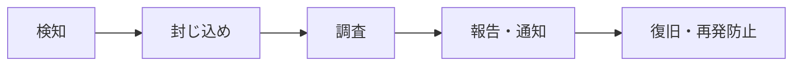

# 07. セキュリティ設計（ゼロトラスト・脆弱性対応）

> ステータス: Draft v0.1 / 2026-10-06
> 背景: 近年の個人情報漏えい事故を踏まえ、「**侵入される前提**」で被害を最小化する設計にする。
> このサービスは「自宅・実家・子どもの学校の位置」を扱うため、**漏えいした場合の影響が大きい**ことを常に意識する。

---

## 1. 基本方針（ゼロトラスト）

| 原則 | このサービスでの意味 |
| --- | --- |
| **常に検証する**（Never trust, always verify） | ネットワークの内側・外側で信頼を分けない。すべての API 呼び出し・AWS 操作で、毎回「誰が・何の権限で」を検証する |
| **最小権限** | 人・CI・Lambda それぞれに必要最小限の権限だけを与える。期限付きの一時クレデンシャルを使う |
| **侵害を前提にする**（Assume breach） | 1つが破られても被害が広がらないよう、データ暗号化・アカウント分離・テナント分離・ログ監視を重ねる |
| **持たない・残さない** | 不要な個人情報はそもそも取得しない。保持期限を過ぎたら自動削除する |

---

## 2. 守るもの（資産）と脅威

| 資産 | 想定される脅威 | 主な対策 |
| --- | --- | --- |
| 利用者の地点（自宅等の位置・住所） | DB 流出、他人の地点の閲覧（認可不備） | アプリ層暗号化、テナント分離、認可テスト |
| アカウント | パスワードリスト攻撃、フィッシング | MFA / パスキー、レート制限、不審ログイン通知 |
| 法人の拠点情報・履歴 | 他社データの閲覧、内部不正 | 組織単位の認可、ロール、監査ログ |
| Slack/Teams Webhook URL | 流出による他社チャンネルへの投稿 | 暗号化保存、画面では伏せ字表示 |
| AWS 環境 | アクセスキー漏えい、CI 経由の侵入 | 長期キーなし（CI は OIDC、人は MFA 付きの一時クレデンシャル）、アカウント分離 |
| ソースコード・依存関係 | 脆弱な/悪意あるライブラリ、Action の改ざん | 依存スキャン、SHA 固定、更新の自動化 |
| 通知の信頼性 | なりすまし通知、デマの拡散 | 公式/SNS の明確な区別、送信元ドメイン認証（SPF/DKIM/DMARC） |

---

## 3. ゼロトラスト対策の詳細

### 3.1 利用者の認証（Identity）

| 項目 | 内容 |
| --- | --- |
| 認証基盤 | Amazon Cognito（パスワードを自前で保存しない） |
| ログイン方式 | パスキー（WebAuthn）を推奨。メール＋パスワードも可 |
| MFA | 個人: 任意（設定を推奨表示）/ **法人: 組織設定で必須化** |
| パスワード | 12文字以上、漏えい済みパスワードの検出（Cognito の脅威保護機能。料金体系は要確認） |
| ブルートフォース対策 | Cognito のロックアウト＋WAF のレート制限 |
| セッション | アクセストークン有効期限 15〜60分、リフレッシュトークン 7〜30日。パスワード変更・MFA変更時は全セッション失効 |
| 通知 | 新しい端末からのログイン、MFA 変更時にメール通知 |
| 将来 | 法人向け SSO（SAML / OIDC）。対応時は料金体系を確認 |

### 3.2 認可（毎リクエストの検証）

- API Gateway の **JWT オーソライザ**で署名・有効期限・発行元を検証（未認証は Lambda まで届かない）
- Lambda 内で**毎リクエスト**次を検証する（デフォルト拒否）
  0. トークンの `sub` から `userId` を引く（`SUB#<issuer>#<sub>` → `userId`。→ [04](./04_data_model.md) 5.1）
  1. 個人の地点 → `ownerKey == OWNER#U#<userId>` か
  2. 組織の拠点 → `ORG#<orgId> / MEMBER#<userId>` が存在し、ロールが操作に足りるか
- **リクエストの `orgId` や `ownerId` を信用しない**。必ずトークンの `sub` から引いた `userId` と所属で判定する
- 認可ロジックは1か所（ミドルウェア）に集約し、**「他人のデータにアクセスできないこと」の自動テスト**を全APIで用意する（IDOR対策）
- ID は推測困難な ULID / UUID を使う（連番を使わない）
- **ログインしないで使う機能**（状況確認の回答 `/check?token=`）は、推測できないワンタイムトークン（128ビット以上、DB にはハッシュのみ保存、72時間で失効）で認可する。トークンで操作できるのは1つの依頼への回答だけにし、WAF でレート制限をかける。認可テストの対象一覧にも含める

| ロール | 閲覧 | 拠点編集 | CSV出力 | メンバー管理 | 組織設定 |
| --- | :-: | :-: | :-: | :-: | :-: |
| viewer | ✓ | | | | |
| editor | ✓ | ✓ | ✓ | | |
| admin | ✓ | ✓ | ✓ | ✓ | |
| owner | ✓ | ✓ | ✓ | ✓ | ✓ |

### 3.3 サービス間の権限（Workload）

| 対象 | 対策 |
| --- | --- |
| Lambda | **関数ごとに専用の IAM ロール**。例: `ingest-jma` は `events` への書き込みと `match-queue` への送信のみ。`api` は `audit` を書けるが削除できない |
| KMS | 暗号化キーの `Decrypt` 権限は `api` と `notifier` のみ。取り込み系には与えない |
| DynamoDB | テーブル単位でアクションを限定。可能な箇所は条件キー（`dynamodb:LeadingKeys`）で範囲を絞る |
| 外部APIトークン | SSM Parameter Store（SecureString）に保存し、該当 Lambda だけが読める |
| S3 | 全バケットでパブリックアクセスをブロック。Web 用バケットは CloudFront（OAC）からのみ読み取り可 |

### 3.4 運用者・開発者のアクセス（人）

| 項目 | 内容 |
| --- | --- |
| AWS へのログイン | 個人運用のため IAM Identity Center は使わない。管理アカウントに運営者用の **IAM ユーザーを1つ**作り、コンソールのパスワード＋MFA だけを設定する。**アクセスキーは作らない** |
| CLI | `aws login`（コンソールのログインから一時クレデンシャルを取得する。AWS CLI v2 の新しいバージョンが必要。要確認）または CloudShell を使う |
| 各環境の操作 | IAM ユーザー自体にはロールの引き受け（`sts:AssumeRole`）以外の権限を与えない。dev / prod のアカウントに `saigai-readonly` / `saigai-admin` ロールを作り、信頼ポリシーで MFA を必須にする（`aws:MultiFactorAuthPresent`） |
| ルートユーザー | MFA を設定して金庫保管。通常は使わない。使用時はアラート |
| 権限 | 普段は ReadOnly。本番の変更は CI 経由のみが原則。緊急時用の権限は期限付きで付与し、使用を記録 |
| 本番データの閲覧 | 原則禁止。調査が必要な場合も暗号化フィールドは復号しない |
| CI/CD | GitHub Actions は OIDC で一時クレデンシャル（→ [06](./06_deploy_flow.md)） |
| GitHub | 2FA 必須、ブランチ保護、`CODEOWNERS`、Actions の SHA 固定、`permissions` 最小化 |

### 3.5 データ保護

| 項目 | 内容 |
| --- | --- |
| 取得の最小化 | **住所は任意**（地図ピンだけで登録可）。氏名・電話番号は取らない |
| アプリ層暗号化 | 正確な座標・住所・Webhook URL は **KMS のデータキーで暗号化**してから DynamoDB に保存（エンベロープ暗号化）。DB が丸ごと流出しても平文は読めない。キーは**マルチリージョンキー**で作り、大阪のレプリカでも復号できるようにする（→ [10](./10_disaster_recovery.md)）。キーは用途で分けずに環境ごとに1つにし、費用を抑える（プライマリ＋レプリカで月 約$2） |
| 粗い位置での処理 | 突き合わせはエリアコードと Geohash6（約1km四方）で行い、正確な座標は本人の画面表示時のみ復号 |
| 保存時暗号化 | DynamoDB・S3・SQS・CloudWatch Logs はすべて暗号化 |
| 通信 | TLS 1.2 以上のみ。HSTS 有効 |
| 保持期限 | TTL で自動削除（→ [04](./04_data_model.md)）。退会時は全データ削除 |
| バックアップ | `app` / `audit` は PITR（35日）。バックアップも暗号化 |
| ログ | 住所・座標・メール・トークンをログに出さない（マスキング関数を共通化、テストで検査） |
| CSV 出力 | 出力操作は監査ログに記録。CSVインジェクション対策（`=` `+` `-` `@` で始まる値をエスケープ） |

### 3.6 Web アプリケーションの対策

| 脅威 | 対策 |
| --- | --- |
| XSS | React のエスケープに任せ、`dangerouslySetInnerHTML` 禁止（lint で検出）。**厳格な CSP**（`script-src 'self'`、外部は地図タイル・Cognito など必要なものだけ許可）。`connect-src` には国土地理院の住所検索（`https://msearch.gsi.go.jp`）を許可する（住所検索は利用者のブラウザから直接呼び、入力した住所をこちらのサーバーに通さない） |
| トークン窃取 | トークンはメモリ保持を基本にし、`localStorage` に長期トークンを置かない。将来 SSR を導入する場合は BFF + HttpOnly Cookie 方式へ移行を検討 |
| クリックジャッキング | `frame-ancestors 'none'` / `X-Frame-Options: DENY` |
| その他ヘッダ | `X-Content-Type-Options: nosniff`、`Referrer-Policy: strict-origin-when-cross-origin`、`Permissions-Policy`（位置情報は自サイトのみ） |
| CORS | API を CloudFront 経由の同一オリジンにし、CORS を開けない |
| SSRF | 利用者が登録する Webhook URL は**許可ドメインのみ**（`hooks.slack.com`、Teams の Webhook ドメイン等）。プライベートIP宛は拒否 |
| 入力 | API 入力はスキーマで検証（型・長さ・範囲）。CSV インポートはサイズ・行数上限を設ける |
| 悪用・過負荷 | WAF（AWS マネージドルール: 共通・既知の悪性入力・IP 評判リスト＋レート制限）、API Gateway のスロットリング |
| メールなりすまし | SES で SPF / DKIM / DMARC を設定 |

> セキュリティヘッダは CloudFront のレスポンスヘッダーポリシーで一括付与（追加料金なし）。

### 3.7 検知・監視（侵害を前提に）

| 対策 | 内容 | 費用感 |
| --- | --- | --- |
| CloudTrail | 全リージョンの管理イベントを記録し、ログ用 S3 は改ざん防止（オブジェクトロック or 別アカウントへ集約） | 管理イベント1証跡は無料（S3 保存料のみ） |
| GuardDuty | 不審な API 呼び出し・認証情報の悪用を検知 | 小規模なら月数ドル |
| IAM Access Analyzer | 外部に公開されているリソースを検出 | 外部アクセス分析は無料 |
| アラート | ルートユーザー使用、IAM ポリシー変更、KMS キー削除予約、GuardDuty の中以上の検知 → 運営者へ即時通知 | ほぼ無料 |
| アプリの異常検知 | 短時間の大量 CSV 出力、ログイン失敗の急増、403 の急増をメトリクス化してアラーム | ほぼ無料 |
| Security Hub / Config | 設定ミスの継続的な検査 | 費用がかかるため**利用者が増えてから導入** |

---

## 4. 脆弱性対応

### 4.1 開発の各段階でのチェック

```mermaid
flowchart LR
  A[コーディング] --> B[PR / CI] --> C[マージ後] --> D[本番運用]
  A -.- A1[IDE lint<br/>pre-commit で gitleaks]
  B -.- B1[依存: govulncheck / npm audit / dependency-review<br/>コード: golangci-lint(gosec) / eslint / CodeQL※<br/>IaC: tflint / trivy config<br/>秘密情報: gitleaks]
  C -.- C1[Dependabot で更新PR自動作成<br/>週次の再スキャン]
  D -.- D1[週次 DAST: OWASP ZAP ベースライン(dev)<br/>GuardDuty / CloudTrail 監視]
```

※ CodeQL は公開リポジトリなら無料。非公開の場合は Semgrep(OSS) 等で代替。

| 種類 | 対象 | ツール（無料） | 実行タイミング |
| --- | --- | --- | --- |
| SCA（依存ライブラリ） | Go | `govulncheck`（実際に呼ばれている脆弱な関数だけ検出） | PR / 週次 |
| SCA | npm | `npm audit`、`dependency-review-action` | PR / 週次 |
| SAST（コード） | Go | `golangci-lint`（`gosec` 含む） | PR |
| SAST | TypeScript | ESLint（セキュリティ系ルール）、CodeQL※ | PR |
| IaC | Terraform | `tflint`、`trivy config` | PR |
| 秘密情報 | 全体 | `gitleaks`（pre-commit と CI の両方） | コミット時 / PR |
| DAST | dev 環境 | OWASP ZAP ベースラインスキャン | 週次 |
| 依存の自動更新 | Go / npm / Actions / Terraform provider | Dependabot | 週次 |

### 4.2 サプライチェーン対策

- `go.sum` / `package-lock.json` をコミットし、CI は `npm ci`（ロックファイル通りにインストール）
- `npm ci --ignore-scripts` でインストール時のスクリプト実行を止める（必要なものだけ許可）
- GitHub Actions の外部 Action は **コミット SHA で固定**し、Dependabot で更新
- 新しい依存を追加するときはレビューで「必要性・メンテ状況・ダウンロード数」を確認
- Dependabot の更新PRは**公開から数日待ってからマージ**（公開直後の悪意あるバージョンを避ける）
- Lambda はコンテナを使わず zip 配布（OS パッケージの脆弱性管理を AWS 管理ランタイムに任せる）

### 4.3 対応期限（SLA）

| 深刻度 | 例 | 対応期限 |
| --- | --- | --- |
| Critical | 認証回避、他人のデータ閲覧、悪用が確認された既知脆弱性 | **24時間以内**に緩和策（機能停止含む）、72時間以内に修正 |
| High | 実際に到達可能な既知脆弱性（govulncheck で検出） | 7日以内 |
| Medium | 条件付きで悪用可能なもの | 30日以内 |
| Low | 影響が限定的なもの | 次回の定期更新で対応 |

- 判断に迷う場合は深刻度を一段上げて扱う
- 対応結果は Issue に記録する（ラベル: `security`）。公開リポジトリの場合、未修正の脆弱性詳細は公開 Issue に書かず GitHub の Security Advisory（非公開）を使う

### 4.4 脆弱性の受付

- `SECURITY.md` を置き、報告窓口（GitHub の非公開脆弱性報告）を明記
- サイトに `/.well-known/security.txt` を配置

---

## 5. インシデント対応（個人情報漏えいを想定）



| フェーズ | 主な対応 |
| --- | --- |
| 検知 | GuardDuty / アラーム / 外部からの報告 |
| 封じ込め | 該当 IAM ロール・トークンの無効化、Cognito の全セッション失効、該当 API の停止（WAF でブロック）、KMS キーの一時無効化（**暗号化データの読み出しを止められる**） |
| 調査 | CloudTrail・監査ログ・アプリログから影響範囲（誰の・何のデータが・いつ）を特定 |
| 報告・通知 | 個人情報保護法に基づく **個人情報保護委員会への報告（速報・確報）と本人への通知**。期限と要件は事前に確認しておく（要確認） |
| 復旧・再発防止 | 原因修正、キー・シークレットのローテーション、振り返りをドキュメント化 |

- 対応手順（Runbook）は `docs/runbooks/` に整備し、年1回は机上訓練を行う
- **アプリ層暗号化をしているため、DB のデータだけが漏れても住所・座標は読めない**ことを、影響評価の前提として説明できるようにしておく

---

## 6. 法務・プライバシー

| 項目 | 内容 |
| --- | --- |
| プライバシーポリシー | 取得する情報・利用目的・保存期間・第三者提供・外部委託先（AWS 等）を明記 |
| 本人の権利 | 開示・訂正・削除の請求に対応（画面から退会＝全削除が可能） |
| 外部データの規約 | 気象庁・P2P地震情報・各SNSの利用規約と出典表示を順守。スクレイピングしない |
| SNS 投稿の扱い | 本文を保存しない。投稿者を特定・追跡する機能を作らない |
| 免責 | 情報の正確性・即時性を保証しない旨、避難判断は公式情報に従う旨を明記 |

---

## 7. 導入フェーズ

| フェーズ | 導入する対策 |
| --- | --- |
| MVP | OIDC デプロイ、MFA 必須の IAM ユーザー（アクセスキーなし）＋ロール切り替え、関数別IAM、アプリ層暗号化、Cognito + MFA（任意）、セキュリティヘッダ、CI の全スキャン、Dependabot、CloudTrail、GuardDuty、予算アラーム |
| Phase 2 | WAF（マネージドルール＋レート制限）、週次 DAST、パスキー、不審ログイン通知 |
| Phase 3（法人提供開始） | 法人の MFA 必須化、監査ログ画面、ロール管理、認可テストの網羅、インシデント Runbook と訓練 |
| Phase 4 | 外部の脆弱性診断（第三者）、SSO、Security Hub / Config、必要に応じて第三者認証の検討 |

> 法人向けの提供を始める前に、**少なくとも Phase 3 までの対策を完了**していることを条件とする。

---

## 8. 未決事項

- [ ] 公開リポジトリにするか（GitHub のセキュリティ機能が無料になる / 実装が公開される）
- [ ] WAF を MVP から入れるか（費用 vs リスク。CloudFront の定額プランの適用可否を確認）
- [ ] Cognito の機能別料金（脅威保護・パスキー）の確認
- [ ] 個人情報保護委員会への報告要件の最新確認
- [ ] KMS キーのローテーション方針（自動ローテーション有効化で問題ないか）

---

次: [08_test_strategy.md](./08_test_strategy.md)
