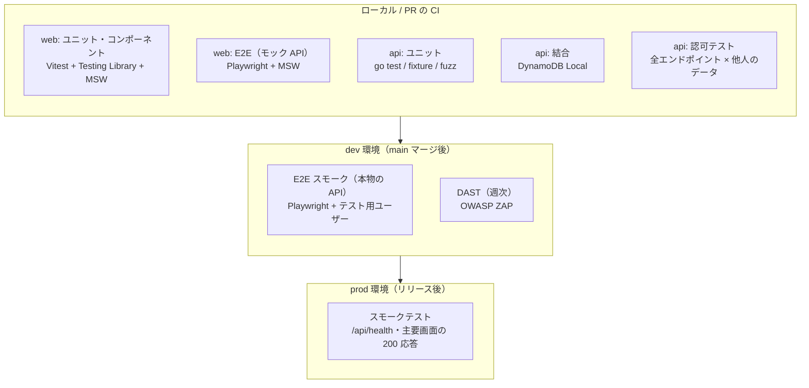
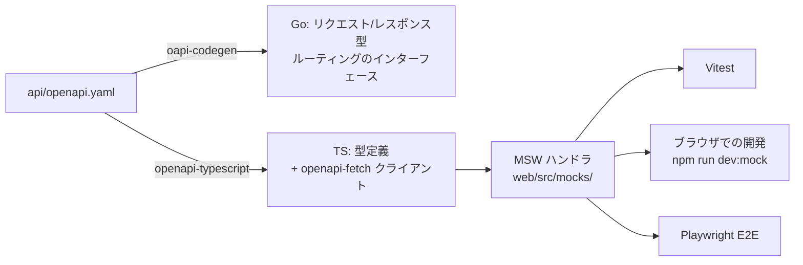

# 08. テスト・動作検証方針（たたき台）

> ステータス: Draft v0.1 / 2026-10-13
> 前提: [05_system_architecture.md](./05_system_architecture.md) / [06_deploy_flow.md](./06_deploy_flow.md) / [07_security.md](./07_security.md)

---

## 1. 方針

| 方針 | 内容 |
| --- | --- |
| **API 仕様を1つにまとめる** | OpenAPI（`api/openapi.yaml`）を正とし、Go のサーバー型・TypeScript のクライアント型・モックをすべてここから作る。モックと本物の API がずれないようにする |
| **フロントはバックエンドなしで動かせる** | MSW（Mock Service Worker）で API をモックし、画面開発・コンポーネントテスト・E2E をバックエンドなしで実行できるようにする |
| **CI から外部サービスを呼ばない** | 気象庁・P2P地震情報・国土地理院・SNS は、保存したレスポンス（fixture）で代替する。外部の障害やレート制限で CI が落ちないようにする |
| **災害時の流れを再現できる** | 実際の電文 XML を順番に流し込み、取り込み → 突き合わせ → 通知までを手元で再現できるようにする |
| **AWS の実環境での確認は dev で行う** | ローカルで再現しにくい部分（Cognito・IAM・CloudFront）は、dev へのデプロイ後に E2E で確認する |

---

## 2. テストの全体像

| 層 | 対象 | ツール | 実行タイミング |
| --- | --- | --- | --- |
| ユニット | Go のドメインロジック・パーサ | `go test`（テーブル駆動）、`go-cmp` | PR |
| ファジング | 電文 XML パーサ、API 入力の検証 | Go 標準のファジング（`go test -fuzz`） | 週次（PR では seed のみ実行） |
| 結合 | リポジトリ層（DynamoDB の条件付き書き込み・TTL・GSI） | DynamoDB Local | PR |
| 認可 | 全 API の IDOR・ロール別権限 | `go test`（共通のテストハーネス） | PR |
| ユニット / コンポーネント | フロントの関数・フック・コンポーネント | Vitest + React Testing Library + MSW | PR |
| E2E（モック） | 主要な画面操作の流れ | Playwright + MSW | PR |
| アクセシビリティ | 主要画面 | `@axe-core/playwright` | PR（E2E の中で実行） |
| E2E（実環境） | ログイン〜地点登録〜タイムライン表示 | Playwright | main マージ後（dev） |
| DAST | dev 環境 | OWASP ZAP ベースライン | 週次（→ [07](./07_security.md)） |
| 負荷 | API・CloudFront | k6 | Phase 2 以降、大きな変更の前に手動で実行 |

---

## 3. API 仕様とモック（フロントとバックエンドの境界）

- **OpenAPI を先に書く**（スキーマ駆動）。API を変更するときは、まず `openapi.yaml` を変更し、型を再生成する
- 生成したコードはコミットし、CI で「再生成しても差分が出ないこと」を確認する
- MSW のハンドラは生成された型を使って書く。API の形が変わると、型エラーでモックの修正漏れに気づける
- Go 側では、テストの中で実際のレスポンスを OpenAPI のスキーマで検証し、仕様と実装のずれを防ぐ（`kin-openapi`）
- モックデータは `web/src/mocks/fixtures/` に置き、「平常時」「大雨警報発表中」「震度6弱」「特別警報」などの**シナリオ単位**で用意する。開発中もシナリオを切り替えて画面を確認できるようにする

---

## 4. フロントエンド（web）

### 4.1 ユニット・コンポーネントテスト

| 対象 | 確認すること |
| --- | --- |
| レベル表示 | 色だけでなく、アイコン・文字でもレベルが分かること（→ [03](./03_screens.md) 5章） |
| 信頼度ラベル | 公式 / 裏付けあり / 未確認 の表示の出し分け |
| ポーリング | 60秒間隔（警報級のときは30秒）とジッターの付与。Vitest の Fake Timers で確認 |
| 認証まわり | トークンを `localStorage` に保存しないこと、期限切れ時のリフレッシュ |
| 入力検証 | 地点登録フォームのエラー表示 |

- テスト環境は jsdom を使う。MapLibre GL JS は WebGL が必要なため、コンポーネントテストではモックに差し替える
- テストは「ユーザーから見える振る舞い」で書く（`getByRole` などを使い、実装の詳細には依存しない）

### 4.2 E2E テスト（Playwright）

| 項目 | 内容 |
| --- | --- |
| 対象のビルド | `npm run build` で作った静的出力（`out/`）を、ローカルで配信してテストする。本番と同じ成果物を検証する |
| API | PR では MSW でモックする。dev 環境では本物の API を使う |
| 端末 | **スマホを優先**（iPhone・Android 相当のビューポート）。法人ダッシュボードのみ PC のビューポートでも確認する |
| ブラウザ | Chromium + WebKit（iPhone の Safari を想定）。Firefox は必要になってから追加する |
| 地図タイル | 国土地理院のタイルへのリクエストは `page.route` で止め、ダミーのタイルを返す。CI から外部のタイルサーバーに負荷をかけない |
| アクセシビリティ | 主要画面で `@axe-core/playwright` を実行し、重大な違反があれば失敗にする |
| 失敗時の記録 | トレース・スクリーンショット・動画を CI のアーティファクトとして保存する |

**シナリオ（MVP）**: [02](./02_use_case_scenarios.md) の想定シナリオから、次の流れを E2E にする。

1. 新規登録 → ログイン → 地点登録（地図にピンを置く）→ ホームに表示される
2. 警報発表中のシナリオで、地点タイムラインにレベル・出典・免責が表示される
3. 通知設定を変更してテスト送信する
4. ログアウトすると、保護された画面にアクセスできない

### 4.3 dev 環境での E2E

- `deploy-dev.yml` のデプロイ後に、上記シナリオのうち 1・2・4 を本物の Cognito・API に対して実行する
- テスト用ユーザーは dev の Cognito にだけ作成し、資格情報は GitHub の Environment シークレットに置く
- テストで作ったデータは、テストの最後に削除する（ユーザーごとのプレフィックスを付けて、消し漏れも `housekeeping` で掃除する）
- トークンはメモリに保持する設計のため、Playwright の `storageState` によるログイン状態の使い回しはできない。各テストの最初にログインする（ログイン処理は共通の fixture にまとめる）

---

## 5. バックエンド（api）

### 5.1 ユニットテスト

| 対象 | 方法 |
| --- | --- |
| 気象庁 XML パーサ | 実際の電文を `testdata/` に保存し、解析結果をゴールデンファイルと比較する。警報の発表・継続・解除、訂正報、取消報を含める |
| severity のマッピング | テーブル駆動で、全種別のマッピング（→ [04](./04_data_model.md) 4.1）を確認する |
| 通知の判定 | レベルが上がったとき・解除時だけ送る、静かな時間帯、特別警報は静かな時間帯を無視する |
| ログのマスキング | 住所・座標・メールアドレス・トークンがログに出ないこと（→ [07](./07_security.md) 3.5） |
| CSV 出力 | CSV インジェクション対策（`=` `+` `-` `@` で始まる値のエスケープ） |
| Webhook URL の検証 | 許可ドメイン以外とプライベート IP を拒否すること（SSRF 対策） |

- 外部 API（気象庁・P2P地震情報・国土地理院・SNS）は `httptest.Server` で fixture を返す。HTTP クライアントは注入できるようにしておく
- AWS SDK を直接呼ぶ部分はインターフェースで包み、ユニットテストではフェイクに差し替える

### 5.2 結合テスト（DynamoDB Local）

- `compose.yaml` で DynamoDB Local を起動する。CI では GitHub Actions のサービスコンテナで起動する
- テーブル定義は Terraform と同じ内容を使い、テスト開始時に作成する（定義のずれを防ぐため、テーブル定義を JSON で共有する）
- 確認すること: 条件付き書き込みによる重複排除（`eventId`）、楽観ロック（`version`）、GSI を使ったアクセスパターン
- 結合テストはビルドタグ `integration` で分け、`go test -tags=integration ./...` で実行する

### 5.3 認可テスト（IDOR 対策）

- **全エンドポイント**について、「ユーザー A のトークンでユーザー B のリソースにアクセスすると 403/404 になる」ことを確認する
- 組織のロール（viewer / editor / admin / owner）× 操作の権限表（→ [07](./07_security.md) 3.2）を、テーブル駆動でそのままテストにする
- **新しいエンドポイントを追加したら、認可テストの対象一覧への追加を必須にする**。一覧に入っていないエンドポイントがあれば、テストが失敗するようにする（ルーティング定義と突き合わせる）

---

## 6. ローカルでの動作確認

### 6.1 起動方法

| モード | コマンド（予定） | 使うもの | 用途 |
| --- | --- | --- | --- |
| フロントのみ | `npm run dev:mock` | Next.js 開発サーバー + MSW | 画面の開発。バックエンド不要 |
| フルスタック | `docker compose up` → `go run ./cmd/local` → `npm run dev` | DynamoDB Local + ローカル API サーバー + Next.js | フロントとバックエンドを繋いだ確認 |
| 災害時の再現 | `go run ./cmd/replay <シナリオ>` | 上記 + 保存した電文 XML | 取り込み〜通知の一連の流れの確認・デモ |

- **ローカル API サーバー**（`api/cmd/local`）: Lambda と同じルーティングを `net/http` のサーバーとして起動する。ハンドラは Lambda 版と共通にする
- **ローカルの認証**: ローカル専用の固定トークンを受け付ける認証ミドルウェアを使う。このコードは**ビルドタグ `local` を付けたときだけビルドされる**ようにし、Lambda のビルドに入らないことを CI で確認する
- **通知**: ローカルでは送信の代わりに、メールは Mailpit で受信して確認する。Slack / Teams・Web Push はログ出力に差し替える
- **SQS**: ローカルではキューを使わず、プロセス内で関数を順番に呼ぶ（ingest → matcher → notifier）

### 6.2 災害シナリオの再現（replay）

- 過去の実際の電文 XML を、時刻順に `testdata/scenarios/<シナリオ名>/` に保存する（例: 大雨警報の発表〜特別警報〜解除、震度6弱の地震と津波注意報）
- `replay` は電文を順番に取り込み、タイムラインと通知の結果を出力する
- 同じシナリオを Go の結合テストでも使い、**通知の回数と内容**をゴールデンファイルで比較する（通知の連打や漏れを防ぐ）
- 電文の利用は気象庁の利用規約に従う

---

## 7. CI への組み込み

[06](./06_deploy_flow.md) の `ci.yml` に、次のジョブとステップを追加する。

| ワークフロー | 追加内容 |
| --- | --- |
| `ci.yml` / api | `go test -race -cover ./...` に加えて、DynamoDB Local をサービスコンテナで起動して `go test -tags=integration ./...`。OpenAPI から生成したコードに差分がないことの確認 |
| `ci.yml` / web | `npm test`（Vitest）に加えて、Playwright E2E（モック API）。生成した型に差分がないことの確認 |
| `deploy-dev.yml` | デプロイ後に Playwright E2E（実環境）を実行する |
| `security-scheduled.yml` | Go のファジングを一定時間だけ実行する |

- Playwright のブラウザはキャッシュし、変更があった部分だけ実行する（パスフィルタ）ことで、CI の実行時間を抑える
- E2E が不安定な場合は、リトライで隠さず原因を直す（リトライは CI で1回までにする）

---

## 8. 目安

| 対象 | 目安 |
| --- | --- |
| `api/internal/` のドメインロジック | カバレッジ 80% 以上 |
| 認可テスト | 全エンドポイントを対象にする（例外なし） |
| 気象庁 XML パーサ | 扱う全電文種別に fixture がある |
| E2E | MVP の主要シナリオ（4.2）をすべて含む |

> カバレッジの数値そのものを目的にしない。「災害時に誤った情報や通知を出さない」「他人のデータが見えない」ことを優先して確認する。

---

## 9. 未決事項

- [ ] Storybook を導入するか（画面のカタログ・見た目の確認用。MSW と組み合わせられる）
- [ ] ビジュアルリグレッション（Playwright のスクリーンショット比較）を導入するか。地図部分は差分が出やすいため対象外にする前提
- [ ] dev 環境の E2E で、通知の受信（メール）まで確認するか（SES の受信設定が必要）
- [ ] 負荷試験の目標値（警報発表時の同時アクセス数の想定）

---

次: [09_release_strategy.md](./09_release_strategy.md)
