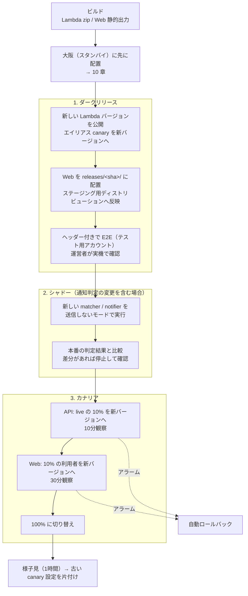
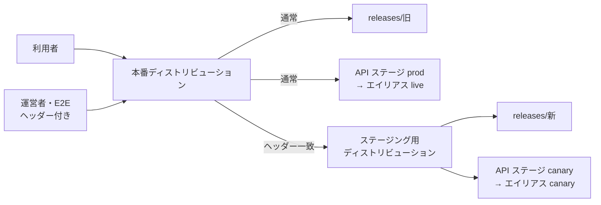
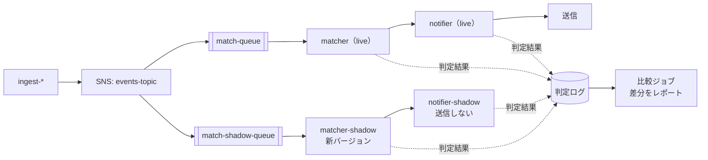
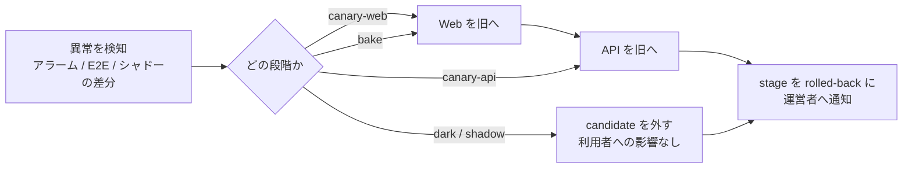

# 09. リリース方式（ブルーグリーン・ダークリリース・カナリア・シャドー）

> ステータス: Draft v0.1 / 2026-10-13
> 前提: [05_system_architecture.md](./05_system_architecture.md) / [06_deploy_flow.md](./06_deploy_flow.md) / [08_test_strategy.md](./08_test_strategy.md)
> 06 の「デプロイ手順」を、段階的に公開する方式へ発展させるための設計。

---

## 1. 方針

| 方針 | 内容 |
| --- | --- |
| **いつでも一瞬で戻せる** | 新旧のバージョンを並べて置き、切り替えるだけでリリース・ロールバックできるようにする（ブルーグリーン） |
| **本番で、利用者より先に確かめる** | 新しいバージョンは、まず運営者だけが本番環境で触れる状態にする（ダークリリース） |
| **影響を一部に絞って公開する** | 一部のリクエストだけを新しいバージョンに流し、問題がなければ広げる（カナリア） |
| **通知は送る前に比べる** | 通知判定の変更は、本番の電文で新旧の判定結果を比べてから切り替える（シャドー） |
| **災害対応中はリリースしない** | 大きな災害が起きている間は、本番へのリリースを止める（デプロイ凍結） |

---

## 2. 用語と、このシステムでの実現方法

| 方式 | 意味 | このシステムでの実現方法 | 主な対象 |
| --- | --- | --- | --- |
| ブルーグリーン | 新旧の環境を並べて置き、一度に切り替える | Lambda: バージョン＋エイリアス `live` の切り替え / Web: リリースごとの S3 プレフィックス＋CloudFront のオリジンパスの切り替え | 全体 |
| ダークリリース | 本番に配置するが、限られた人（運営者・テスト用アカウント）にしか見えない | CloudFront 継続的デプロイの**ヘッダーによる振り分け** → ステージング用ディストリビューション → 新しい Web ＋ 新しい API | web・api |
| カナリア | 一部の利用者・リクエストだけを新しいバージョンに流し、段階的に広げる | API: CodeDeploy＋エイリアスの重み付けルーティング / Web: CloudFront 継続的デプロイの**重みによる振り分け** | web・api |
| シャドー | 本番のデータを新しいバージョンにも流すが、結果は利用者に届けない | 電文を SNS で2つのキューに分岐し、新しい `matcher` / `notifier` を**送信しないモード**で動かして、判定結果を比べる | matcher・notifier |

> 「ダークカナリア」は、**ダークリリースで運営者が確認 → カナリアで一部の利用者に公開 → 全体に公開**という段階を踏むものとして扱う。

---

## 3. 対象ごとの方式

| 対象 | MVP | Phase 2 | Phase 3 |
| --- | --- | --- | --- |
| Web（Next.js） | ブルーグリーン（オリジンパスの切り替え） | ＋ダークリリース・カナリア（CloudFront 継続的デプロイ） | - |
| `api` | ブルーグリーン（エイリアスの切り替え） | ＋ダークリリース（API のステージ `canary`）・カナリア（CodeDeploy） | - |
| `matcher` / `notifier` | ブルーグリーン | - | ＋シャドー実行 |
| 取り込み系（`ingest-*`） | ブルーグリーン | ＋リリース前に保存した電文で再生テスト（→ [08](./08_test_strategy.md) 6.2） | - |
| インフラ（Terraform） | plan したファイルをそのまま apply（→ [06](./06_deploy_flow.md)） | - | - |

- 取り込み系は1分に1回の実行で、同時実行数も1のため、リクエストを割合で分けるカナリアは意味がない。**事前の再生テストと、すぐ戻せること**で安全性を確保する
- データストア（DynamoDB）は新旧のバージョンで共有する。そのため、**新旧のバージョンが同時に動いても壊れない変更しか入れない**（6章）

---

## 4. リリースの流れ（Phase 3 の完成形）



| 段階 | 承認 | 自動ロールバックの条件 |
| --- | --- | --- |
| ダークリリース | 不要（自動） | E2E の失敗 |
| シャドー | 差分がなければ自動、あれば人が判断 | - |
| カナリア開始 | **GitHub Environment `prod` の承認**（06 の承認をここに移す） | 7章のアラーム |
| 100% への切り替え | 不要（観察時間が終わったら自動） | 7章のアラーム |

---

## 5. 方式ごとの詳細

### 5.1 Web のブルーグリーン（MVP）

06 の「`s3 sync --delete` で上書きする」方式をやめて、リリースごとにプレフィックスを分ける。

```
s3://saigai-prod-web/
├── releases/
│   ├── <sha-旧>/        # HTML など（リリースごと）
│   └── <sha-新>/
└── assets/_next/static/ # ハッシュ付きファイル（全リリースで共有し、追記のみ）
```

- CloudFront のオリジンパスを `/releases/<sha>` に切り替えるだけでリリースが完了する。ロールバックも、オリジンパスを戻すだけでできる
- `/_next/static/*` は共有の `assets/` に**追記のみ**で配置する。古い HTML を開いたままの利用者が、古い JS を読み込んでも 404 にならないようにするため
- 古いリリースは直近5世代を残す。`assets/` は30日以上参照されていないものをライフサイクルで削除する

### 5.2 ダークリリース（Phase 2）



- CloudFront 継続的デプロイの「ヘッダーによる振り分け」を使う。決めたヘッダー（例: `aws-cf-cd-saigai: <ランダムな値>`）が付いたリクエストだけが、ステージング用ディストリビューションに届く
  - ヘッダーの値は推測されないものにして、GitHub のシークレットに置く。分かっても見えるのは公開前の画面だけだが、未公開の機能が見えないようにする
- API は、API Gateway のステージ変数で呼び出すエイリアスを切り替える（`prod` ステージ → `live`、`canary` ステージ → `canary`）（要検証: HTTP API でのステージ変数の扱い）
- **ダークリリースでも本番のデータを使う**。確認はテスト用アカウントだけで行い、実際の利用者のデータは触らない
- 将来、機能単位で出し分けたくなった場合は、AWS AppConfig の機能フラグを検討する（Phase 2 では入れない）

### 5.3 カナリア（Phase 2）

| 対象 | 方法 | 段階 |
| --- | --- | --- |
| `api` | CodeDeploy（Lambda 向け）で、エイリアス `live` の重みを段階的に変える | `Canary10Percent10Minutes` |
| Web | CloudFront 継続的デプロイの「重みによる振り分け」（最大15%）。同じ利用者が新旧を行き来しないよう、セッションの固定を有効にする | 10% で30分 → 昇格 |

- **API を先に、Web を後に**リリースする。新しい Web は新しい API を前提にしてよいが、新しい API は古い Web からも使えなければならない
- CodeDeploy のフックを使う
  - `BeforeAllowTraffic`: 新しいバージョンを直接呼び出し、契約テスト（OpenAPI との照合）とヘルスチェックを行う
  - `AfterAllowTraffic`: スモークテストを行う
- CodeDeploy（Lambda 向け）は追加料金がかからない

### 5.4 シャドー（Phase 3）



- 05 の「取り込み → SQS」の間に SNS を挟み、同じ電文を本番用とシャドー用の2つのキューに流す
- シャドー用の関数には、**送信の権限（SES・Webhook の復号用の KMS など）を IAM で与えない**。設定の間違いで実際に通知が送られることを、仕組みとして防ぐ
- 判定結果（どの地点に・どのレベルで・通知するかどうか）を、新旧それぞれで記録し、比較ジョブで差分を出す。判定ログには地点の ID だけを残し、座標や住所は残さない
- 平常時でも全国のどこかで注意報・警報は出ているため、数時間動かせば十分な件数を比べられる。足りない場合は、保存した災害シナリオの電文を流す

---

## 6. 互換性のルール（新旧が同時に動いても壊れないために）

| ルール | 内容 |
| --- | --- |
| 拡張してから縮小する | 属性や API のフィールドは「追加 → 新旧が両方対応 → 古いものを削除」の順に、**別々のリリース**で行う |
| 読み取り時に補う | 新しい属性がないデータは、読み取るときにデフォルト値で補う（→ [06](./06_deploy_flow.md) 6.4） |
| API は後方互換 | 必須パラメータの追加、レスポンスのフィールド削除・型変更をしない。必要な場合はバージョンを分ける |
| キューのメッセージ | メッセージにバージョン番号を持たせ、新旧どちらのバージョンのメッセージも処理できるようにする |
| 書き込み形式の変更 | 新しいバージョンが書いたデータを、古いバージョンが読んでも壊れないこと（ロールバックに備える） |

---

## 7. 自動ロールバックの条件

| 指標 | しきい値（初期値） |
| --- | --- |
| `api` のエラー率（新バージョン） | 1% 以上が2分続く |
| API の 5xx | 旧バージョンより明らかに多い |
| API の p95 レイテンシ | 1.5秒以上が5分続く |
| Lambda のスロットリング | 1件以上 |
| CloudFront の 5xx（ステージング） | 1% 以上 |
| DLQ のメッセージ数 | 1件以上 |

- しきい値は運用しながら調整する。新しいバージョンのアラームは、エイリアス・バージョン単位のメトリクスで作る

---

## 8. ロールバック（ダークカナリアの各段階）

### 8.1 リリースの状態を記録する

どの段階からでも正しく戻せるよう、リリースの状態を**リージョンごとに** SSM Parameter Store に記録する。デプロイ・ロールバックのスクリプトは、必ずこの記録を読み書きする。

| パラメータ | 内容 |
| --- | --- |
| `/saigai/release/live` | 利用者に公開中のリリース（git の SHA、各 Lambda のバージョン番号、Web のプレフィックス） |
| `/saigai/release/previous` | 1つ前の公開リリース（ロールバック先） |
| `/saigai/release/candidate` | ダークリリース・カナリア中のリリース |
| `/saigai/release/stage` | 現在の段階（`dark` / `shadow` / `canary-api` / `canary-web` / `bake` / `done`） |

### 8.2 段階ごとの戻し方

| 段階 | 利用者への影響 | 戻し方 | 自動 / 手動 |
| --- | --- | --- | --- |
| ダークリリース | なし（運営者だけ） | エイリアス `canary` を `live` と同じバージョンに戻す。ステージング用ディストリビューションへの振り分けを無効にする | E2E の失敗で自動 |
| シャドー | なし（送信しない） | シャドー用キューのイベントソースマッピングを無効にし、キューを空にする | 差分の検出で自動停止 |
| カナリア（API） | 一部の利用者 | CodeDeploy のデプロイを止めて、`live` の重みを旧バージョン 100% に戻す | アラームで自動 |
| カナリア（Web） | 一部の利用者 | 継続的デプロイのポリシーを無効にし、全員を本番用ディストリビューション（旧 Web）に戻す | アラームで自動 |
| 様子見（100% 後） | 全員 | ブルーグリーンの切り戻し（`live` エイリアスとオリジンパスを `previous` に戻す） | アラームで自動 / `rollback.yml` で手動 |
| 片付け後 | 全員 | 前のリリースを、通常のリリースとして再デプロイする（ダークリリースを省略してよい） | 手動 |



### 8.3 戻すときのルール

| ルール | 内容 |
| --- | --- |
| **Web を先に、API を後に戻す** | 新しい Web は新しい API を前提にしているため、API だけを先に戻すと、新しい Web を使っている利用者の画面が壊れる |
| **ロールバックはデプロイ凍結の対象外** | 災害対応中でも、ロールバックは承認なしで実行できる（9章） |
| **両方のリージョンを戻す** | 東京と大阪の両方を戻す。戻し忘れると、DR の切り替え時に古い不具合のあるバージョンが動く（→ [10](./10_disaster_recovery.md) 9章） |
| 戻すのは1回のコマンドで | `opsctl release rollback` で、記録された段階に応じて必要な操作をすべて行う（8.4） |
| データは戻さない | DynamoDB のデータは新旧で共有しているため、ロールバックしてもデータは戻らない。6章の互換性のルールで、新しいバージョンが書いたデータを古いバージョンが読めるようにしておく |

**新しいバージョンが不正なデータを書いた場合**:

- すべての書き込みに `writtenBy`（リリースの SHA）の属性を付けておき、影響を受けたデータを特定できるようにする
- 修正は `api/cmd/migrate-<name>` のスクリプトで行い、まず dev で、次に prod で実行する（→ [06](./06_deploy_flow.md) 6.4）

### 8.4 リリース操作のスクリプト（`opsctl release`）

| コマンド | 内容 |
| --- | --- |
| `opsctl release status` | 両方のリージョンの `live` / `candidate` / `stage` と、エイリアスの重み・オリジンパスの実際の状態を表示し、記録とずれていないか確認する |
| `opsctl release promote` | 次の段階に進める（通常は CI から実行） |
| `opsctl release rollback` | 現在の段階に応じて、8.2 の戻し方を実行する |
| `opsctl release rollback --to <sha>` | 指定したリリースに戻す（片付け後の戻し用） |

- `opsctl` は Go で書いた CLI で、DR の操作（[10](./10_disaster_recovery.md) 5.5）と共通にする
- GitHub Actions の `rollback.yml` も、中で `opsctl release rollback` を呼ぶだけにする。**CI からでも手元からでも同じ操作になる**ようにする

---

## 9. デプロイ凍結（災害対応中）

| 条件 | 対応 |
| --- | --- |
| 特別警報・大津波警報が出ている、または過去6時間以内に震度6弱以上の地震があった | 本番へのリリースを止める（`deploy-prod.yml` の最初で `events` テーブルを確認する） |
| 凍結中に修正が必要な場合 | `hotfix` ラベル＋2人の承認で、凍結を解除してリリースできる |
| 凍結中のロールバック | **凍結の対象外**。承認なしで実行できる（8.3） |

- 利用者が最も多いときに、新しい不具合を持ち込まないため
- 凍結を判定するために `events` を読む専用のロールを用意する（書き込み権限は与えない）

---

## 10. コスト

| 項目 | 費用 |
| --- | --- |
| Lambda のバージョン・エイリアス・重み付け | 追加料金なし |
| CodeDeploy（Lambda 向け） | 追加料金なし |
| CloudFront 継続的デプロイ | 機能の追加料金なし（通常のリクエスト料金のみ） |
| シャドー実行 | Lambda・SQS・SNS の実行分（小規模なら無料枠内〜$1/月） |
| 古いリリースの保存（S3） | 数セント/月 |

---

## 11. 未決事項

- [ ] CloudFront 継続的デプロイと、使う予定の機能（HTTP/3・CloudFront の定額プランなど）が両立するか（継続的デプロイには使えない設定があるため要確認）
- [ ] HTTP API のステージ変数で、Lambda のエイリアスを切り替えられるか（要検証。できなければ `canary` 用の API を別に作る）
- [ ] シャドー実行の判定ログの保存先（DynamoDB の TTL 付きテーブルか、S3 か）
- [ ] 06 の `deploy-prod.yml` を、この方式に合わせて書き直す時期
- [ ] リリースの状態の記録先（SSM Parameter Store で十分か。同時に操作したときの排他をどうするか）

---

次: [10_disaster_recovery.md](./10_disaster_recovery.md)
