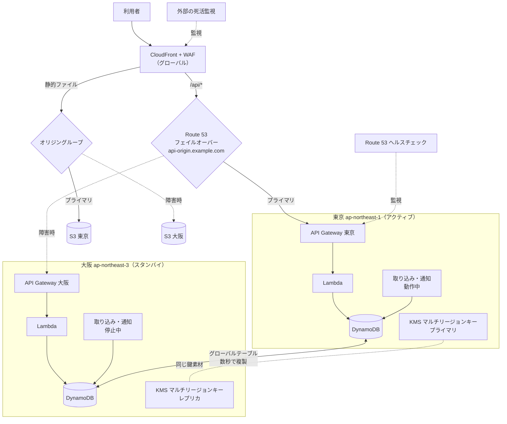
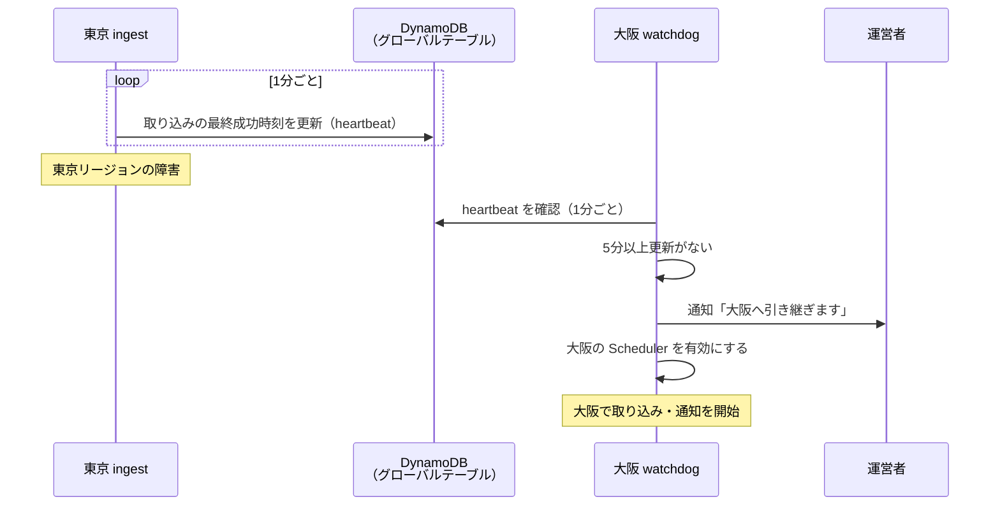
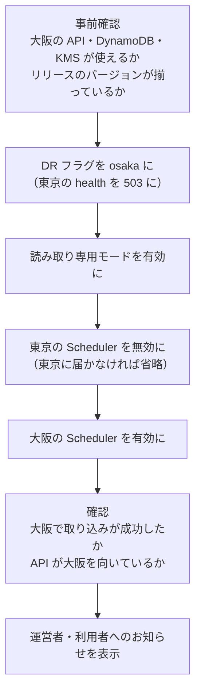

# 10. 災害復旧（DR）・事業継続

> ステータス: Draft v0.1 / 2026-10-13
> 前提: [05_system_architecture.md](./05_system_architecture.md) / [07_security.md](./07_security.md) / [09_release_strategy.md](./09_release_strategy.md)

---

## 1. なぜ DR が特に重要か

このサービスは「**災害が起きた瞬間に最も使われる**」。一方で、本番環境を置く東京リージョン（ap-northeast-1）は首都圏にあり、首都直下地震などの大規模災害では、**サービスの需要が最大になる瞬間と、サービス自体が被災する瞬間が重なる**可能性がある。

さらに、次のことも起こりうる。

- 運営者自身が被災し、すぐに対応できない
- 情報源（気象庁・P2P地震情報）が止まる、または遅れる
- アクセスが集中し、外部サービスのレート制限にかかる

そのため、「東京リージョンが止まっても、**公式情報の表示と通知は続ける**」ことを DR の目標にする。

---

## 2. 想定するシナリオ

| シナリオ | 影響 | 対応 |
| --- | --- | --- |
| 1つの AZ の障害 | 小 | サーバーレスのサービスは複数の AZ で動くため、AWS 側で吸収される。対応不要 |
| **東京リージョンの障害**（大規模災害・広域障害） | 大 | **大阪リージョン（ap-northeast-3）に切り替える**（本章の中心） |
| us-east-1 の障害 | 中 | CloudFront・WAF・ACM（CloudFront 用）・IAM の設定変更ができなくなる。配信そのものは続くため、障害中は設定を変更しない |
| 情報源の停止 | 中 | 気象庁 XML と P2P地震情報で互いに補う（→ [05](./05_system_architecture.md)）。両方止まったら、画面に「情報の取得が遅れています」と表示する |
| データの破損・誤削除・ランサムウェア | 大 | 削除できない保管庫（Vault Lock）のバックアップから戻す（7章）。**リージョン間の複製は削除も複製されるため、バックアップの代わりにならない** |
| AWS アカウントの侵害 | 大 | 07 のインシデント対応。個人運用のためアカウントは1つ（→ 05 6章）。バックアップは Vault Lock（コンプライアンスモード）で、管理者権限でも保持期間内は消せないようにする。アカウントの閉鎖などには耐えられないため、法人向けの提供前に別アカウントへのコピーを検討する |
| 運営者が対応できない | 中 | 読み取りの切り替えは自動にする。手順書は、運営者以外でも実行できる粒度で書く |

---

## 3. 目標（RTO / RPO）

機能を重要度で分け、すべてを同じ目標にはしない。

| 区分 | 機能 | RTO（復旧までの時間） | RPO（失ってよいデータ） | 東京リージョンの障害時 |
| --- | --- | --- | --- | --- |
| **Tier 0** | 画面の配信、公式情報の取り込み、通知の送信 | **15分** | 電文: 0（取り直す）/ 設定: 数秒 | 大阪で継続する |
| **Tier 1** | ログインしてタイムラインを見る | 1時間 | 数秒 | 大阪で継続する（4.4 の課題あり） |
| Tier 2 | 地点・設定の変更、組織の管理、CSV 出力 | 復旧まで停止してよい | 数秒 | 読み取り専用にする |
| Tier 3 | SNS の取り込み（Phase 2） | 復旧まで停止してよい | - | 停止する |

- 電文は気象庁・P2P地震情報から取り直せるため、取り込みのデータは失っても問題ない
- 利用者の設定（地点・通知先）は DynamoDB のグローバルテーブルで数秒以内に大阪に複製されている

---

## 4. 方式

### 4.1 方式の比較

| 方式 | 内容 | RTO | 平常時のコスト | 評価 |
| --- | --- | --- | --- | --- |
| バックアップ＋復元 | 障害時に大阪で一から構築する | 数時間 | ほぼ 0 | 災害時に数時間止まるのは、このサービスでは許されない |
| パイロットライト | データだけ複製し、障害時にアプリを構築する | 30分〜1時間 | 小 | 障害時の作業が多く、運営者が被災していると難しい |
| **ウォームスタンバイ（採用）** | 大阪にも全体を構築しておき、取り込みだけ止めておく | **数分〜15分** | **小**（サーバーレスは待機中の費用がほぼかからない） | 採用 |
| アクティブ / アクティブ | 両方のリージョンで常に処理する | ほぼ 0 | 中 | 通知の重複・二重処理の制御が難しい。将来の検討事項 |

- サーバーレスの構成（Lambda・API Gateway・SQS・Scheduler）は、**使わなければほとんど費用がかからない**。そのため、大阪にも同じ構成を常に置いておいても、コストはほぼ増えない

### 4.2 構成図

### 4.3 コンポーネントごとの対応

| コンポーネント | 平常時 | 東京リージョンの障害時 |
| --- | --- | --- |
| Web（S3） | 東京・大阪の両方に配置（デプロイ時に両方へ） | CloudFront のオリジングループが**自動で**大阪に切り替える |
| API（API Gateway + Lambda） | 両方に配置。カスタムドメイン `api-origin` を Route 53 のフェイルオーバーで向ける | ヘルスチェックの失敗で**自動で**大阪に切り替わる |
| DynamoDB | **グローバルテーブル**（東京・大阪） | 大阪のテーブルをそのまま使う |
| KMS | **マルチリージョンキー**（東京がプライマリ、大阪がレプリカ） | 大阪のレプリカで復号できる |
| 取り込み（Scheduler） | 東京: 有効 / 大阪: 無効 | 大阪で有効にする（5.2） |
| SQS | 両方に作成 | 大阪のキューを使う（処理中のメッセージは失われるが、取り直しで補う） |
| SES | 両方でドメイン認証（DKIM）と本番利用の申請を済ませておく | 大阪から送信する |
| Web Push | VAPID の鍵を両方の SSM に置く | 大阪から送信する |
| SSM Parameter Store | Terraform で両方に作成（値は手順書に従って両方へ登録） | 大阪の値を使う |
| Cognito | **4.4 を参照（最大の課題）** | - |
| 原文 XML（S3） | 東京のみ（30日保持。取り直せるため複製しない） | 大阪に新しく保存する |
| CloudFront・WAF・Route 53 | グローバル | 影響なし |

### 4.4 Cognito の課題（最大の制約）

Cognito のユーザープールはリージョンごとのサービスで、**別のリージョンへの複製機能がない**。パスワードやパスキーも取り出せないため、大阪に同じユーザーを作ることはできない。

| 選択肢 | 内容 | 評価 |
| --- | --- | --- |
| A. 障害中はログインできない | Tier 0（公開画面・通知）だけ継続する | 最も簡単。**通知は届く**ので、最低限の価値は守れる |
| **B. 大阪に予備のユーザープールを用意（推奨）** | 障害時は、メールのワンタイムコードでログインしてもらう。メールアドレスで元のユーザーと紐付ける | ログイン済みの機能も継続できる。ただし下記の前提が必要 |
| C. 外部の認証サービスに移す | リージョンに依存しない認証サービスを使う | 費用・依存先が増える。現時点では採用しない |

**選択肢 B の前提（決定済み: 04 に反映）**:

- データのキーに **Cognito の `sub` を直接使わない**。アプリ独自の `userId`（ULID）を発行し、`sub → userId` の対応表を持つ
  - 04 のキーは `USER#<userId>` / `OWNER#U#<userId>` / `MEMBER#<userId>` にした
  - 予備のユーザープールでログインしたときは、メールアドレスのハッシュ（`EMAIL#<emailHash>`）から `userId` を引いて紐付ける
- 予備のユーザープールへのユーザーの登録は、メールアドレスだけを定期的に同期する（パスワードは同期できない・しない）

> 後からデータのキーを変えるのは大変なため、**実装を始める前に決める**。

---

## 5. 切り替えの手順

### 5.1 自動で切り替えるもの（読み取り）

| 対象 | 仕組み | 切り替わるまで |
| --- | --- | --- |
| 静的ファイル | CloudFront のオリジングループ（5xx・タイムアウトで大阪へ） | リクエストごとに即時 |
| API | Route 53 のヘルスチェック（`/api/health`）＋フェイルオーバーレコード | 1〜3分程度 |

- CloudFront のオリジングループは GET / HEAD / OPTIONS だけが対象のため、API の切り替えには Route 53 を使う
- 切り替えの判断には Route 53 のデータプレーン（ヘルスチェック）を使い、障害時に操作が必要なコントロールプレーンには頼らない
- **計画的に切り替えるとき**（訓練・東京の部分的な障害）も、Route 53 の設定は変更しない。DynamoDB の DR フラグ（`CONFIG#dr`）を `osaka` にすると、東京の `/api/health` が 503 を返すようにし、ヘルスチェックの仕組みで切り替える。Route 53 のコントロールプレーン（us-east-1）が使えなくても切り替えられる

### 5.2 取り込み・通知の引き継ぎ（半自動）

取り込みは、東京と大阪で同時に動くと通知が二重に送られるため、引き継ぎを制御する。

- 大阪の `watchdog`（1分ごとに実行する Lambda）が、東京の heartbeat を見て、**5分間更新がなければ自動で引き継ぐ**
- 運営者が被災していても通知が止まらないよう、引き継ぎは自動にする。運営者は通知を受けて状況を確認する
- 手動で引き継ぐ・戻すときは、切り替えスクリプト `opsctl dr`（5.5）を使う。watchdog の自動引き継ぎも、中では同じ処理を呼ぶ

**通知の重複について**:

- 東京が実は動いていて、複製だけが止まっている場合などは、**両方のリージョンから通知が送られる**可能性がある
- このサービスでは「**通知の欠落より、重複のほうがましである**」と考え、まれな重複は許容する
- 通知に電文の ID を含め、利用者の画面では同じ情報を1件にまとめて表示する

### 5.3 書き込みの扱い

- 障害中、大阪でも書き込みはできる（グローバルテーブルはどちらのリージョンでも書き込める）
- ただし、東京の復旧直後に同じデータを両方で更新すると、後から書いたほうが優先される。障害中は **Tier 2（設定の変更など）を読み取り専用にする**機能フラグを用意し、切り替え時に有効にする

### 5.4 東京への切り戻し

1. `opsctl dr status` で、東京の復旧とグローバルテーブルの複製が追いついていることを確認する
2. `opsctl dr failback` を実行する。大阪の取り込みを止める → 東京の取り込みを再開する、を**同時に動かさない**順番で行い、DR フラグを `tokyo` に戻す
3. Route 53 のヘルスチェックが正常に戻り、API が東京に戻ることを確認する（`failback` の最後に自動で確認する）
4. `opsctl dr readonly off` で読み取り専用モードを解除する
5. 振り返りを `docs/runbooks/` に記録する

### 5.5 切り替えスクリプト（`opsctl dr`）

切り替えの手順は、**手作業の AWS コンソール操作ではなく、すべてスクリプトで実行する**。被災した状況や、運営者以外が実行する場合でも、間違えずに実行できるようにするため。

**実装**: リリース操作（[09](./09_release_strategy.md) 8.4）と共通の Go の CLI `opsctl`（`api/cmd/opsctl`）。AWS SDK を使い、外部のツールに依存しない1つのバイナリにする。

| コマンド | 内容 |
| --- | --- |
| `opsctl dr status` | 両方のリージョンの状態を表示する（heartbeat の時刻、どちらで取り込み中か、DR フラグ、Route 53 のヘルスチェックの状態、グローバルテーブルの複製の遅れ、リリースのバージョンが揃っているか、DLQ の件数） |
| `opsctl dr failover` | 大阪へ切り替える（下の手順） |
| `opsctl dr failback` | 東京へ戻す（5.4） |
| `opsctl dr readonly on\|off` | Tier 2 の機能を読み取り専用にする / 解除する |
| `opsctl dr drill` | 訓練用。本番で、利用者の少ない時間に `failover` → 確認 → `failback` を続けて実行し、かかった時間を記録する |

**`failover` の手順**（各ステップは、すでに完了していれば何もしない＝何度実行しても安全）:

| 設計のルール | 内容 |
| --- | --- |
| **何もしないで確認する（`--dry-run`）を初期値にする** | 実行する操作の一覧だけを表示する。実際に操作するには `--execute` を付ける |
| **何度実行しても安全** | 途中で失敗しても、もう一度実行すれば続きから進む |
| **東京に依存しない** | `failover` の中では東京の API を呼ばない（呼べたら呼ぶが、失敗しても先に進む）。大阪のエンドポイントとグローバルなデータプレーンだけで完了できるようにする |
| リージョンを明示する | 誤って逆のリージョンを操作しないよう、操作対象のリージョンを毎回表示し、`prod` の操作では環境名の入力を求める |
| 記録を残す | 実行した操作と結果を、大阪の DynamoDB（`audit`）と標準出力の両方に記録する |

**実行する場所**（どれか1つが使えれば切り替えられるようにする）:

| 場所 | 方法 | 認証 |
| --- | --- | --- |
| GitHub Actions | `dr.yml`（手動実行。コマンドを選んで `opsctl` を呼ぶだけ） | OIDC（**大阪の STS エンドポイント**を使う） |
| 運営者の端末 | GitHub Releases に置いた `opsctl` のバイナリ | 運営者用の IAM ユーザー（MFA 必須）で `aws login` → ロールを引き受ける（→ [07](./07_security.md) 3.4） |
| AWS CloudShell（大阪） | `opsctl` のバイナリを取得して実行 | コンソールのログイン（要確認: 大阪での CloudShell の提供状況） |

- watchdog（5.2）の自動引き継ぎも、`opsctl` と同じ Go のパッケージを呼ぶ。**自動でも手動でも同じ手順になる**ようにする
- `opsctl` のテストは、AWS をフェイクに差し替えたユニットテストに加えて、`--dry-run` での確認と本番での `opsctl dr drill` で確認する（8章）

---

## 6. 運用者側の備え

| 課題 | 対策 |
| --- | --- |
| 運営者のログインが東京に依存しないか | IAM Identity Center は使わず、IAM ユーザー（グローバルなサービス）でログインするため、東京の障害時もログインできる。ロールの引き受けには大阪の STS エンドポイントを使う |
| Terraform の state が東京の S3 にある | 障害中は Terraform を使わずに済むよう、**切り替えに必要なものはすべて事前に構築しておく**。切り替えは AWS CLI のワークフローで行う。state のバケットは大阪にも複製する |
| 監視が東京にある | 東京が止まるとアラームも止まる。**大阪の watchdog と、外部の死活監視サービス**（CloudFront 経由の画面と `/api/health`）でも監視する |
| 運営者が被災している | 手順書（`docs/runbooks/dr.md`）は運営者以外でも実行できる粒度で書く。自動で切り替わる範囲を広くしておく |
| 利用者への案内 | 障害中は画面上部にお知らせを表示する（静的ファイルとして大阪にも置いておく）。ステータスページは AWS の外に置く |

---

## 7. バックアップ（データの破損・誤削除・ランサムウェアへの備え）

グローバルテーブルは**削除や破損も複製する**ため、別にバックアップが必要。

| 対象 | 方法 | 保持期間 |
| --- | --- | --- |
| `app` / `audit` | PITR（35日）（→ [04](./04_data_model.md)） | 35日 |
| `app` / `audit` | AWS Backup で毎日バックアップし、Vault Lock（コンプライアンスモード）の保管庫に置く。大阪リージョンの保管庫にもコピーする | 90日 |
| KMS | キーの削除予約にはアラートを出す（→ [07](./07_security.md)）。マルチリージョンキーのレプリカは、プライマリと別に削除予約が必要 | - |

- 暗号化したバックアップは、KMS のキーがないと復号できない。キーの削除予約にはアラートを出す（キーを消されるとバックアップも読めなくなる）
- 年に1回、バックアップを別名のテーブルに復元して中身を確認する訓練を行う（dev 環境は作らないため）

---

## 8. 訓練

| 訓練 | 頻度 | 内容 |
| --- | --- | --- |
| 切り替え訓練（dev） | 四半期ごと | `opsctl dr drill` で、大阪への切り替え・切り戻しを確認する。別の回では東京の取り込みを止め、watchdog の自動引き継ぎも確認する |
| 切り替え訓練（prod） | 年1回（平常時・利用が少ない時間帯） | 実際に大阪へ切り替えて、Tier 0 / Tier 1 が動くことを確認する |
| バックアップからの復元 | 年1回 | 7章 |
| 机上訓練 | 年1回 | 首都直下地震を想定し、運営者が対応できない場合も含めて手順を確認する（07 のインシデント訓練と合わせて実施） |

- 切り替えの訓練は、利用者の少ない時間に本番で `opsctl dr drill` を行う（dev 環境は作らないため）

---

## 9. デプロイとの関係

- デプロイは**大阪（スタンバイ）を先に、東京を後に**行う。大阪へのデプロイの失敗は利用者に影響しないため、先に問題に気づける（→ [09](./09_release_strategy.md)）
- 大阪と東京で、Lambda のバージョンと Web のリリースを常に揃える。揃っていない場合はアラートを出す
- 大阪でもスモークテストを行う（ヘルスチェックを大阪の API に直接送る）
- ロールバックも両方のリージョンに対して行う（→ [09](./09_release_strategy.md) 8.3）
- **DR で大阪に切り替えている間のリリース**: 災害対応中のデプロイ凍結と同じ扱いにし、ロールバックと `hotfix` 以外はリリースしない。リリースする場合も東京には配置せず、大阪だけを更新する（東京の復旧後、切り戻しの前にバージョンを揃える）

---

## 10. コスト（追加分 / 月）

| 項目 | 概算 |
| --- | --- |
| DynamoDB グローバルテーブル（複製の書き込み・大阪側の保存） | 〜$1〜2 |
| KMS マルチリージョンキーのレプリカ | $1 × キーの数 |
| Route 53 ヘルスチェック | $0.5〜1 × 1〜2 |
| 大阪の Lambda・API Gateway・SQS・Scheduler（待機中） | ほぼ $0 |
| 大阪の S3（Web）・CloudWatch | 〜$1 |
| AWS Backup（大阪へのコピー） | 〜$1 |
| 外部の死活監視 | 無料プランの範囲 |
| **合計** | **約 $4〜8 / 月** |

> 05 の概算（$15〜25/月）に加えて、合計で約 $20〜33/月の見込み。料金は変わるため、構築時に最新を確認すること。

---

## 11. 実装前に決める必要があること（後から変えにくいもの）

| 項目 | 理由 |
| --- | --- |
| **KMS をマルチリージョンキーで作る**（決定済み） | 既存の単一リージョンのキーを、後からマルチリージョンキーに変えることはできない。単一リージョンのキーで暗号化したデータは、大阪では復号できない |
| **データのキーに `userId` を使い、Cognito の `sub` を使わない**（決定済み） | 4.4 の選択肢 B のため。後から変えると全データの移行が必要になる |
| API のカスタムドメインの構成 | CloudFront → `api-origin` ドメイン → Route 53 フェイルオーバー、という経路を最初から作っておく |
| 取り込みの heartbeat の仕組み | 監視（05 の「取り込みの停止」）と DR の引き継ぎで共通にする |

グローバルテーブル・大阪のスタンバイ環境そのものは、後から追加できる。**MVP では 11章の項目だけを先に満たし、大阪の構築は Phase 2 で行う**ことも選択肢になる。

---

## 12. 未決事項

- [ ] DR の導入時期（MVP から入れるか、Phase 2 か）
- [ ] 大阪リージョンでの各サービス（Cognito・SES・EventBridge Scheduler など）の提供状況と機能差の確認
- [ ] 外部の死活監視・ステータスページのサービス選定
- [ ] 自動引き継ぎのしきい値（5分）が適切か
